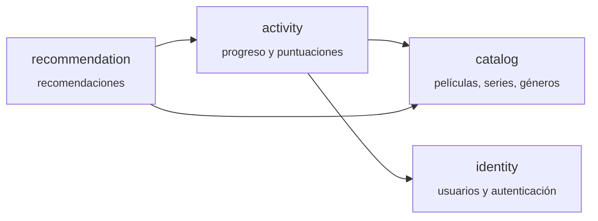

# StreamStories

[English](README.md) · **Español**

**API REST para una plataforma de catálogo audiovisual bajo demanda:** películas, series con temporadas y episodios, géneros, progreso de reproducción, puntuaciones y recomendaciones personalizadas.

[](https://github.com/paulaciano/streamstories/actions/workflows/ci.yml)


---

## ¿Qué hace?

| | Funcionalidad |
|---|---|
| 🎬 **Catálogo** | Películas y series (con temporadas y episodios), clasificadas en varios géneros a la vez. Se puede explorar un catálogo mixto filtrado por género, tipo o texto. |
| 👤 **Cuentas** | Registro, inicio de sesión con JWT, roles `USER` y `ADMIN`. Las cuentas se pueden desactivar, y su reactivación la aprueba un administrador. |
| ▶️ **Seguir viendo** | Guarda la posición exacta de reproducción de cada película o episodio, que cuenta como visto al llegar al 90 %. Muestra las películas sin terminar y cada serie con el último episodio visto. |
| ⭐ **Puntuaciones** | Calificaciones de 1 a 5 para películas y series, con el promedio en el detalle de cada título. |
| 💡 **Recomendaciones** | Sugerencias basadas en los géneros que el usuario mira y valora, con el motivo de cada una. |
| 🔖 **Lista de seguimiento** | Películas y series guardadas para ver después. |
| 🎞️ **Sagas** | Películas relacionadas agrupadas en el orden en que conviene verlas. |
| 🗄️ **Retiro de contenido** | El contenido que deja de ofrecerse se retira sin borrarse, así no se pierde la actividad de los usuarios. |

La API gestiona el catálogo y la actividad. La reproducción del video ocurre en el cliente, a partir de la URL de cada contenido ([ADR-0004](docs/adr/0004-video-as-metadata.md)).

El contenido del catálogo (títulos, sinopsis, géneros) está en español; la API, el código y la documentación, en inglés.

## Arquitectura en un vistazo

Es un **monolito modular**: una sola aplicación Spring Boot dividida en módulos por funcionalidad. [Spring Modulith](https://docs.spring.io/spring-modulith/reference/) verifica los límites entre módulos en cada build.



**Stack:** Java 25 · Spring Boot 4 (Web MVC, Data JPA, Security, Validation, Actuator) · PostgreSQL · Flyway · Spring Modulith · springdoc-openapi · JUnit 6 · Testcontainers · GitHub Actions.

## Cómo probarlo en tu máquina

### 1. Requisitos

| Herramienta | Para qué | Cómo verificarlo |
|-------------|----------|------------------|
| [JDK 25](https://adoptium.net/temurin/releases/?version=25) | Compilar y ejecutar la aplicación | `java -version` muestra `25` |
| [Docker](https://docs.docker.com/get-started/get-docker/) (Docker Desktop o Docker Engine), **en ejecución** | Levantar PostgreSQL | `docker info` responde sin errores |
| [Git](https://git-scm.com/downloads) | Clonar el repositorio | `git --version` |

No hace falta instalar Maven ni PostgreSQL: el proyecto trae el wrapper de Maven (`./mvnw`), y la base corre en un contenedor. Los puertos `8080` (la API) y `5432` (PostgreSQL) tienen que estar libres.

### 2. Clonar y arrancar

```bash
git clone https://github.com/paulaciano/streamstories.git
cd streamstories
./mvnw spring-boot:run
```

En Windows, usá `mvnw.cmd spring-boot:run`. La primera vez tarda unos minutos, porque descarga las dependencias y la imagen de PostgreSQL. La aplicación está lista cuando el log muestra `Started StreamstoriesApplication`.

Al arrancar con `./mvnw spring-boot:run` se activa el perfil de desarrollo (`dev`), que:

- levanta PostgreSQL con [Docker Compose](compose.yaml) y crea las tablas;
- carga un **catálogo de ejemplo**: 8 películas y 3 series con temporadas y episodios, en 6 géneros, con una película y una temporada retiradas;
- crea un **administrador de desarrollo**: `admin@streamstories.local`, con la contraseña `dev-admin-password`.

| | URL |
|---|---|
| Swagger UI | http://localhost:8080/swagger-ui.html |
| Especificación OpenAPI | http://localhost:8080/v3/api-docs |
| Estado de salud | http://localhost:8080/actuator/health |

### 3. Probar la API desde Swagger UI

1. Abrí http://localhost:8080/swagger-ui.html.
2. En **Authentication**, abrí `POST /api/v1/auth/login`, tocá **Try it out** y enviá:
   ```json
   { "email": "admin@streamstories.local", "password": "dev-admin-password" }
   ```
3. Copiá el valor de `accessToken` de la respuesta.
4. Tocá **Authorize** (arriba a la derecha), pegá el token **sin** escribir `Bearer` delante y confirmá.
5. Ya podés usar cualquier endpoint, por ejemplo `GET /api/v1/catalog`.

El administrador ve todo, incluido el contenido retirado. Para ver la API como un usuario común, registrá una cuenta con `POST /api/v1/auth/register`, iniciá sesión con ella y autorizá con ese token. El access token dura 15 minutos: cuando vence, volvé a iniciar sesión.

### 4. Probar la API desde la terminal

```bash
# Registrar un usuario e iniciar sesión
curl -s -X POST localhost:8080/api/v1/auth/register -H 'Content-Type: application/json' \
  -d '{"email": "ana@example.com", "password": "una-clave-segura", "displayName": "Ana"}'
TOKEN=$(curl -s -X POST localhost:8080/api/v1/auth/login -H 'Content-Type: application/json' \
  -d '{"email": "ana@example.com", "password": "una-clave-segura"}' | sed -E 's/.*"accessToken":"([^"]+)".*/\1/')

# Explorar el catálogo y buscar un título
curl -s localhost:8080/api/v1/catalog -H "Authorization: Bearer $TOKEN"
curl -s "localhost:8080/api/v1/catalog?q=orbita" -H "Authorization: Bearer $TOKEN"

# Puntuar un título (reemplazá TITLE_ID por un id del catálogo) y pedir recomendaciones
curl -s -X PUT localhost:8080/api/v1/me/ratings/TITLE_ID -H "Authorization: Bearer $TOKEN" \
  -H 'Content-Type: application/json' -d '{"score": 5}'
curl -s localhost:8080/api/v1/me/recommendations -H "Authorization: Bearer $TOKEN"
```

Todos los endpoints, con sus parámetros y ejemplos, están en [Diseño de la API](docs/04-api.md).

### 5. Detener y empezar de cero

- **Detener:** `Ctrl+C` en la terminal donde corre la aplicación. Si el contenedor de PostgreSQL sigue corriendo (`docker ps` lo muestra), `docker compose stop` lo detiene. Los datos se conservan para la próxima vez.
- **Empezar de cero:** `docker compose down -v` borra la base local. Al volver a arrancar, se cargan de nuevo el catálogo de ejemplo y el administrador.

### 6. Correr los tests

```bash
./mvnw verify
```

Ejecuta el chequeo de formato, los tests unitarios y de integración, y la verificación de módulos. Los tests de integración usan un PostgreSQL real con [Testcontainers](https://testcontainers.com/), así que **Docker tiene que estar en ejecución**: si no, se omiten sin fallar. Para formatear el código: `./mvnw spotless:apply`.

### Problemas frecuentes

| Síntoma | Causa y solución |
|---------|------------------|
| `release version 25 not supported` o un error de versión de Java | Hay otro JDK activo. Instalá el JDK 25 y verificá con `java -version`; si tenés varios, configurá `JAVA_HOME` para que apunte al 25. |
| La aplicación no arranca y menciona Docker Compose | Docker no está en ejecución. Abrí Docker Desktop (o iniciá el servicio) y verificá con `docker info`. |
| `port is already allocated` o `Address already in use` | Otro proceso usa el puerto `5432` o el `8080`, por ejemplo un PostgreSQL instalado localmente. Detenelo antes de arrancar. |
| `401` en todos los endpoints de Swagger UI | Falta el token o venció. Volvé a iniciar sesión y cargalo en **Authorize**. |
| `429` al iniciar sesión | Hubo 5 contraseñas incorrectas para ese email en 15 minutos. Esperá los segundos que indica `Retry-After`. |

### Imagen de contenedor

`./mvnw spring-boot:build-image` arma la imagen `streamstories:<versión>` con [Cloud Native Buildpacks](https://docs.spring.io/spring-boot/maven-plugin/build-image.html), sin `Dockerfile`. Está pensada para otros entornos: no incluye el perfil `dev`, así que necesita un PostgreSQL propio y las variables de [`.env.example`](.env.example):

```bash
docker run -p 8080:8080 --env-file .env streamstories:<versión>
```

## Documentación

La documentación completa está en [`docs/`](docs/README.md), en inglés:

- [Visión y alcance](docs/01-vision-and-scope.md)
- [Arquitectura](docs/02-architecture.md)
- [Modelo de dominio y datos](docs/03-domain-model.md)
- [Diseño de la API](docs/04-api.md)
- [Seguridad](docs/05-security.md)
- [Calidad y flujo de trabajo](docs/06-quality-and-workflow.md)
- [Hoja de ruta](docs/07-roadmap.md)
- [Desarrollo asistido por IA](docs/08-ai-assisted-development.md)
- [Registro de decisiones de arquitectura (ADR)](docs/adr/README.md)

## Estado del proyecto

El desarrollo avanzó por fases ([hoja de ruta](docs/07-roadmap.md)), y con la versión `1.0.0` están todas completas:

| Fase | Alcance | Estado |
|------|---------|:------:|
| 0 · Cimientos | Configuración base, CI, manejo de errores, OpenAPI | ✅ Completada |
| 1 · MVP | Catálogo, cuentas y autenticación | ✅ Completada |
| 2 · Interacción | Progreso de reproducción, historial y puntuaciones | ✅ Completada |
| 3 · Inteligencia | Recomendaciones personalizadas | ✅ Completada |
| 4 · Evolución | Lista de seguimiento, sagas y optimizaciones | ✅ Completada |

## Licencia

Distribuido bajo la [licencia MIT](LICENSE).
