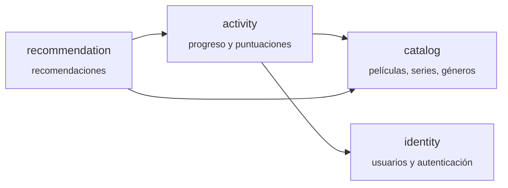

# StreamStories

**API REST para una plataforma de catálogo audiovisual bajo demanda:** películas, series con temporadas y episodios, géneros, progreso de reproducción, puntuaciones y recomendaciones personalizadas.

[](https://github.com/paulaciano/streamstories/actions/workflows/ci.yml)


---

## ¿Qué hace?

| | Funcionalidad |
|---|---|
| 🎬 **Catálogo** | Películas y series (con temporadas y episodios), clasificadas en varios géneros a la vez. Se puede explorar un catálogo mixto filtrado por género, tipo o texto. |
| 👤 **Cuentas** | Registro, inicio de sesión con JWT, roles `USER` y `ADMIN`. Las cuentas se pueden desactivar, y su reactivación la aprueba un administrador. |
| ▶️ **Seguir viendo** | Guarda la posición exacta de reproducción de cada película o episodio, que cuenta como visto al llegar al 90 %. Muestra las películas sin terminar y cada serie con el último episodio visto. |
| ⭐ **Puntuaciones** | Calificaciones de 1 a 5 para películas y series, con el promedio en el detalle de cada título. |
| 💡 **Recomendaciones** | Sugerencias basadas en los géneros que el usuario mira y valora, con el motivo de cada una. |
| 🔖 **Lista de seguimiento** | Películas y series guardadas para ver después. |
| 🎞️ **Sagas** | Películas relacionadas agrupadas en el orden en que conviene verlas. |
| 🗄️ **Retiro de contenido** | El contenido que deja de ofrecerse se retira sin borrarse, así no se pierde la actividad de los usuarios. |

La API gestiona el catálogo y la actividad. La reproducción del video ocurre en el cliente, a partir de la URL de cada contenido ([ADR-0004](docs/adr/0004-video-como-metadato.md)).

## Arquitectura en un vistazo

Es un **monolito modular**: una sola aplicación Spring Boot dividida en módulos por funcionalidad. [Spring Modulith](https://docs.spring.io/spring-modulith/reference/) verifica los límites entre módulos en cada build.



**Stack:** Java 25 · Spring Boot 4 (Web MVC, Data JPA, Security, Validation, Actuator) · PostgreSQL · Flyway · Spring Modulith · springdoc-openapi · JUnit 6 · Testcontainers · GitHub Actions.

## Cómo ejecutarlo

**Requisitos:** [JDK 25](https://adoptium.net/temurin/releases/?version=25) y [Docker](https://docs.docker.com/get-started/get-docker/).

```bash
git clone https://github.com/paulaciano/streamstories.git
cd streamstories
./mvnw spring-boot:run
```

Spring Boot levanta PostgreSQL automáticamente con Docker Compose, con el perfil de desarrollo (`dev`). Ese perfil:

- carga un **catálogo de ejemplo**: 8 películas y 3 series con temporadas y episodios, en 6 géneros. Incluye una película y una temporada retiradas;
- crea un **administrador de desarrollo**: `admin@streamstories.local` con la contraseña `dev-admin-password`.

Para explorar la API, iniciá sesión con `POST /api/v1/auth/login` y usá el access token en el botón *Authorize* de Swagger UI. Para ver el catálogo como usuario, registrá una cuenta con `POST /api/v1/auth/register`.

Los datos de ejemplo y el administrador se crean solo si todavía no existen. Para empezar de cero, `docker compose down -v` borra la base local. Para otros entornos, las variables necesarias están en [`.env.example`](.env.example).

Con la aplicación en marcha:

| | URL |
|---|---|
| Swagger UI | http://localhost:8080/swagger-ui.html |
| Especificación OpenAPI | http://localhost:8080/v3/api-docs |
| Estado de salud | http://localhost:8080/actuator/health |

**Imagen de contenedor:** `./mvnw spring-boot:build-image` arma la imagen `streamstories:<versión>` con [Cloud Native Buildpacks](https://docs.spring.io/spring-boot/maven-plugin/build-image.html), sin `Dockerfile`. Se ejecuta con las variables de [`.env.example`](.env.example), apuntando a un PostgreSQL propio:

```bash
docker run -p 8080:8080 --env-file .env streamstories:<versión>
```

La imagen no incluye el perfil `dev`: necesita la clave JWT y la conexión a la base.

**Tests:** `./mvnw verify` ejecuta el formato, los tests unitarios y de integración (con [Testcontainers](https://testcontainers.com/)) y la verificación de módulos. Para formatear el código: `./mvnw spotless:apply`.

## Documentación

La documentación completa está en [`docs/`](docs/README.md):

- [Visión y alcance](docs/01-vision-y-alcance.md)
- [Arquitectura](docs/02-arquitectura.md)
- [Modelo de dominio y datos](docs/03-modelo-de-dominio.md)
- [Diseño de la API](docs/04-api.md)
- [Seguridad](docs/05-seguridad.md)
- [Calidad y flujo de trabajo](docs/06-calidad-y-flujo-de-trabajo.md)
- [Hoja de ruta](docs/07-hoja-de-ruta.md)
- [Desarrollo asistido por IA](docs/08-desarrollo-con-ia.md)
- [Registro de decisiones de arquitectura (ADR)](docs/adr/README.md)

## Estado del proyecto

El desarrollo avanzó por fases ([hoja de ruta](docs/07-hoja-de-ruta.md)), y con la versión `1.0.0` están todas completas:

| Fase | Alcance | Estado |
|------|---------|:------:|
| 0 · Cimientos | Configuración base, CI, manejo de errores, OpenAPI | ✅ Completada |
| 1 · MVP | Catálogo, cuentas y autenticación | ✅ Completada |
| 2 · Interacción | Progreso de reproducción, historial y puntuaciones | ✅ Completada |
| 3 · Inteligencia | Recomendaciones personalizadas | ✅ Completada |
| 4 · Evolución | Lista de seguimiento, sagas y optimizaciones | ✅ Completada |

## Licencia

Distribuido bajo la [licencia MIT](LICENSE).
