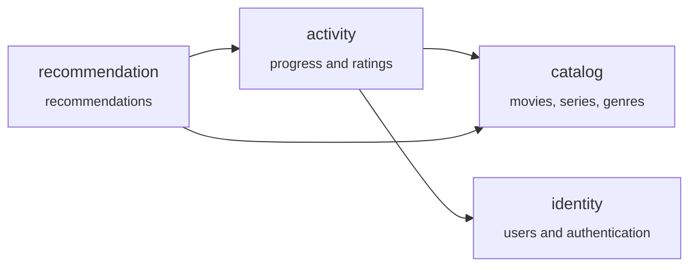

# StreamStories

**English** · [Español](README.es.md)

**REST API for an on-demand streaming catalog:** movies, series with seasons and episodes, genres, watch progress, ratings and personalized recommendations.

[](https://github.com/paulaciano/streamstories/actions/workflows/ci.yml)


---

## What does it do?

| | Feature |
|---|---|
| 🎬 **Catalog** | Movies and series (with seasons and episodes), classified in several genres at once. A mixed catalog can be browsed and filtered by genre, type or text. |
| 👤 **Accounts** | Sign-up, JWT login, `USER` and `ADMIN` roles. Accounts can be deactivated, and an administrator approves their reactivation. |
| ▶️ **Continue watching** | Saves the exact playback position of each movie or episode, which counts as watched at 90%. Shows the unfinished movies and each series with its last watched episode. |
| ⭐ **Ratings** | Scores from 1 to 5 for movies and series, with the average in each title's detail. |
| 💡 **Recommendations** | Suggestions based on the genres the user watches and rates, each with its reason. |
| 🔖 **Watchlist** | Movies and series saved to watch later. |
| 🎞️ **Franchises** | Related movies grouped in the order they are best watched. |
| 🗄️ **Retiring content** | Content that stops being offered is retired instead of deleted, so no user activity is lost. |

The API manages the catalog and the activity. Video playback happens on the client, from each piece of content's URL ([ADR-0004](docs/adr/0004-video-as-metadata.md)).

The catalog content (titles, synopses, genres) is in Spanish; the API, the code and the documentation are in English.

## Architecture at a glance

It is a **modular monolith**: a single Spring Boot application split into modules by feature. [Spring Modulith](https://docs.spring.io/spring-modulith/reference/) checks the module boundaries on every build.



**Stack:** Java 25 · Spring Boot 4 (Web MVC, Data JPA, Security, Validation, Actuator) · PostgreSQL · Flyway · Spring Modulith · springdoc-openapi · JUnit 6 · Testcontainers · GitHub Actions.

## How to try it on your machine

### 1. Requirements

| Tool | What for | How to check it |
|------|----------|-----------------|
| [JDK 25](https://adoptium.net/temurin/releases/?version=25) | Build and run the application | `java -version` shows `25` |
| [Docker](https://docs.docker.com/get-started/get-docker/) (Docker Desktop or Docker Engine), **running** | Start PostgreSQL | `docker info` answers without errors |
| [Git](https://git-scm.com/downloads) | Clone the repository | `git --version` |

There is no need to install Maven or PostgreSQL: the project includes the Maven wrapper (`./mvnw`), and the database runs in a container. Ports `8080` (the API) and `5432` (PostgreSQL) must be free.

### 2. Clone and start

```bash
git clone https://github.com/paulaciano/streamstories.git
cd streamstories
./mvnw spring-boot:run
```

On Windows, use `mvnw.cmd spring-boot:run`. The first run takes a few minutes, because it downloads the dependencies and the PostgreSQL image. The application is ready when the log shows `Started StreamstoriesApplication`.

`./mvnw spring-boot:run` enables the development profile (`dev`), which:

- starts PostgreSQL with [Docker Compose](compose.yaml) and creates the tables;
- loads a **sample catalog**: 8 movies and 3 series with seasons and episodes, in 6 genres, with one retired movie and one retired season;
- creates a **development administrator**: `admin@streamstories.local`, with the password `dev-admin-password`.

| | URL |
|---|---|
| Swagger UI | http://localhost:8080/swagger-ui.html |
| OpenAPI specification | http://localhost:8080/v3/api-docs |
| Health | http://localhost:8080/actuator/health |

### 3. Try the API from Swagger UI

1. Open http://localhost:8080/swagger-ui.html.
2. Under **Authentication**, open `POST /api/v1/auth/login`, click **Try it out** and send:
   ```json
   { "email": "admin@streamstories.local", "password": "dev-admin-password" }
   ```
3. Copy the `accessToken` value from the response.
4. Click **Authorize** (top right), paste the token **without** typing `Bearer` before it, and confirm.
5. You can now call any endpoint, for example `GET /api/v1/catalog`.

The administrator sees everything, including retired content. To use the API as a regular user, sign up with `POST /api/v1/auth/register`, log in with that account and authorize with its token. The access token lasts 15 minutes: when it expires, log in again.

### 4. Try the API from the terminal

```bash
# Sign up and log in
curl -s -X POST localhost:8080/api/v1/auth/register -H 'Content-Type: application/json' \
  -d '{"email": "ana@example.com", "password": "a-secure-password", "displayName": "Ana"}'
TOKEN=$(curl -s -X POST localhost:8080/api/v1/auth/login -H 'Content-Type: application/json' \
  -d '{"email": "ana@example.com", "password": "a-secure-password"}' | sed -E 's/.*"accessToken":"([^"]+)".*/\1/')

# Browse the catalog and search for a title
curl -s localhost:8080/api/v1/catalog -H "Authorization: Bearer $TOKEN"
curl -s "localhost:8080/api/v1/catalog?q=orbita" -H "Authorization: Bearer $TOKEN"

# Rate a title (replace TITLE_ID with an id from the catalog) and get recommendations
curl -s -X PUT localhost:8080/api/v1/me/ratings/TITLE_ID -H "Authorization: Bearer $TOKEN" \
  -H 'Content-Type: application/json' -d '{"score": 5}'
curl -s localhost:8080/api/v1/me/recommendations -H "Authorization: Bearer $TOKEN"
```

Every endpoint, with its parameters and examples, is in [API design](docs/04-api.md).

### 5. Stop and start from scratch

- **Stop:** `Ctrl+C` in the terminal where the application runs. If the PostgreSQL container keeps running (`docker ps` lists it), `docker compose stop` stops it. The data is kept for the next time.
- **Start from scratch:** `docker compose down -v` deletes the local database. On the next start, the sample catalog and the administrator are loaded again.

### 6. Run the tests

```bash
./mvnw verify
```

It runs the format check, the unit and integration tests, and the module verification. Integration tests use a real PostgreSQL through [Testcontainers](https://testcontainers.com/), so **Docker must be running**: otherwise they are skipped without failing. To format the code: `./mvnw spotless:apply`.

### Common problems

| Symptom | Cause and fix |
|---------|---------------|
| `release version 25 not supported`, or another Java version error | Another JDK is active. Install JDK 25 and check with `java -version`; if you have several, set `JAVA_HOME` to point to 25. |
| The application does not start and mentions Docker Compose | Docker is not running. Open Docker Desktop (or start the service) and check with `docker info`. |
| `port is already allocated` or `Address already in use` | Another process uses port `5432` or `8080`, for example a locally installed PostgreSQL. Stop it before starting. |
| `401` on every endpoint in Swagger UI | The token is missing or expired. Log in again and load it in **Authorize**. |
| `429` when logging in | There were 5 wrong passwords for that email in 15 minutes. Wait the seconds that `Retry-After` indicates. |

### Container image

`./mvnw spring-boot:build-image` builds the `streamstories:<version>` image with [Cloud Native Buildpacks](https://docs.spring.io/spring-boot/maven-plugin/build-image.html), without a `Dockerfile`. It is meant for other environments: it does not include the `dev` profile, so it needs its own PostgreSQL and the variables in [`.env.example`](.env.example):

```bash
docker run -p 8080:8080 --env-file .env streamstories:<version>
```

## Documentation

The full documentation is in [`docs/`](docs/README.md):

- [Vision and scope](docs/01-vision-and-scope.md)
- [Architecture](docs/02-architecture.md)
- [Domain model and data](docs/03-domain-model.md)
- [API design](docs/04-api.md)
- [Security](docs/05-security.md)
- [Quality and workflow](docs/06-quality-and-workflow.md)
- [Roadmap](docs/07-roadmap.md)
- [AI-assisted development](docs/08-ai-assisted-development.md)
- [Architecture decision records (ADR)](docs/adr/README.md)

## Project status

Development went through phases ([roadmap](docs/07-roadmap.md)), and with version `1.0.0` all of them are complete:

| Phase | Scope | Status |
|-------|-------|:------:|
| 0 · Foundations | Base configuration, CI, error handling, OpenAPI | ✅ Done |
| 1 · MVP | Catalog, accounts and authentication | ✅ Done |
| 2 · Interaction | Watch progress, history and ratings | ✅ Done |
| 3 · Intelligence | Personalized recommendations | ✅ Done |
| 4 · Evolution | Watchlist, franchises and optimizations | ✅ Done |

## License

Distributed under the [MIT license](LICENSE).
