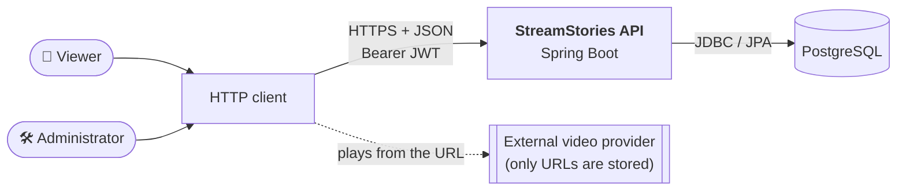
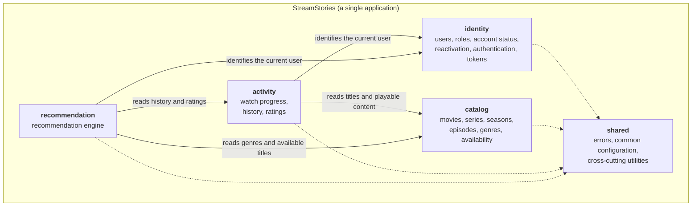
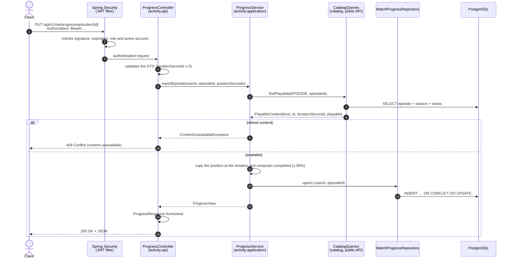

# 2. Architecture

## 2.1 Summary

StreamStories is a **modular monolith**: a single [Spring Boot](https://docs.spring.io/spring-boot/) application deployed as one unit. Inside, it is organized in **modules by feature**, with explicit boundaries that tests verify ([ADR-0002](adr/0002-modular-monolith.md)).

This approach keeps the operational simplicity of a monolith while keeping the domain well separated. If it were ever needed, a module could be extracted as a service without redesigning the domain.

## 2.2 System context



The API **does not serve video**. It stores the URL and the duration of each piece of playable content. The client plays the video from that URL and reports the progress to the API ([ADR-0004](adr/0004-video-as-metadata.md)).

## 2.3 Technology stack

| Area | Technology | Why |
|------|------------|-----|
| Language | [Java 25](https://openjdk.org/projects/jdk/25/) (LTS) | Long-term support release, with records, sealed types, pattern matching and virtual threads. |
| Framework | [Spring Boot 4](https://docs.spring.io/spring-boot/) | The standard for Java backends, with a mature ecosystem. |
| Web | [Spring Web MVC](https://docs.spring.io/spring-framework/reference/web/webmvc.html) | A synchronous REST API. With virtual threads there is no need for a reactive stack. |
| Persistence | [Spring Data JPA](https://docs.spring.io/spring-data/jpa/reference/) + [Hibernate](https://hibernate.org/orm/documentation/) | Object-relational mapping and declarative repositories. |
| Database | [PostgreSQL](https://www.postgresql.org/docs/) | A robust relational database, with good support for constraints and partial indexes. Search uses the [`unaccent`](https://www.postgresql.org/docs/current/unaccent.html) extension, which a migration creates (the database owner can do it without being a superuser). |
| Migrations | [Flyway](https://documentation.red-gate.com/flyway) | A schema versioned in SQL and reviewable in each PR ([ADR-0006](adr/0006-flyway-migrations.md)). |
| Validation | [Jakarta Bean Validation](https://beanvalidation.org/) | Declarative validation of the input DTOs. |
| Security | [Spring Security](https://docs.spring.io/spring-security/reference/) + [OAuth2 Resource Server (JWT)](https://docs.spring.io/spring-security/reference/servlet/oauth2/resource-server/jwt.html) | Standard JWT validation, without hand-made libraries ([ADR-0005](adr/0005-jwt-authentication.md)). |
| API documentation | [springdoc-openapi](https://springdoc.org/) | Generates the OpenAPI 3 specification and Swagger UI from the code. |
| Modularity | [Spring Modulith](https://docs.spring.io/spring-modulith/reference/) | A test checks that no module breaks its boundaries. |
| Observability | [Spring Boot Actuator](https://docs.spring.io/spring-boot/reference/actuator/index.html) | Health checks and application info. |
| Testing | [JUnit 6](https://docs.junit.org/current/user-guide/), [AssertJ](https://assertj.github.io/doc/), [Mockito](https://site.mockito.org/), [Testcontainers](https://testcontainers.com/) | Integration tests against a real PostgreSQL. |
| Build | [Maven Wrapper](https://maven.apache.org/tools/wrapper/) | Builds without installing Maven. |
| Local environment | [Docker Compose](https://docs.docker.com/compose/) + [Spring Boot support](https://docs.spring.io/spring-boot/reference/features/dev-services.html) | PostgreSQL starts on its own with the application. |
| Container image | [Cloud Native Buildpacks](https://docs.spring.io/spring-boot/maven-plugin/build-image.html) (`./mvnw spring-boot:build-image`) | A reproducible, maintained image, without writing or maintaining a `Dockerfile`. |
| CI | [GitHub Actions](https://docs.github.com/actions) | Build, tests and checks on every push and PR. |

## 2.4 Modules



| Module | Responsibility | Depends on | Phase |
|--------|----------------|------------|-------|
| `identity` | Sign-up, login, tokens, roles, account status, reactivation requests, security configuration | `shared` | 1 |
| `catalog` | Managing the catalog and the franchises, retiring content, search and filters by genre or type | `shared` | 1 |
| `activity` | Watch progress, history, "continue watching", ratings, watchlist | `catalog`, `identity`, `shared` | 2 |
| `recommendation` | Personalized recommendations | `activity`, `catalog`, `identity`, `shared` | 3 |
| `shared` | Global error handling (`ProblemDetail`), auditing and common types | — | 1 |

**Dependency rules:**

1. There are no cycles: the graph is directed and acyclic.
2. `catalog` **does not know** about users or their activity. The catalog exists even if nobody watches it.
3. A module uses another **only through its public API**, made of the types in the module's root package. It never reaches the internal entities or repositories of another module.
4. Spring Modulith checks these rules in a test (`ModularityTests`), and the build fails if one is broken.

Example: to record the progress of an episode, `activity` does not use `EpisodeRepository`. It calls `CatalogQueries.findPlayable(kind, id)`, a public `catalog` interface that returns a read-only `PlayableContent` with the duration and whether the content can be played. Likewise, it takes the current user from the token with `identity.CurrentUser`.

When `catalog` needs to know something about activity, the dependency is inverted. To avoid deleting content with activity (rule C11), `catalog` publishes the `ContentActivity` interface, which `activity` implements. The same goes for the ratings shown in a title's detail: `catalog` publishes `TitleRatings` and `activity` implements it. That way `catalog` still depends on no other module.

## 2.5 Package structure

The code is organized **by feature** (*package by feature*), not by technical layer. Each module is split into layers:

```
src/main/java/com/amillioncodelines/streamstories/
├── StreamstoriesApplication.java
├── catalog/
│   ├── ContentActivity.java         ← public API: interface implemented by the modules with activity
│   ├── ContentKind.java
│   ├── CatalogQueries.java          ← public API: read-only queries for other modules
│   ├── PlayableContent.java         ← and the MovieSummary, EpisodeSummary and TitleSummary summaries
│   ├── TitleRatings.java            ← public API: ratings for the detail, implemented by activity
│   ├── RatingSummary.java
│   ├── api/                         ← HTTP entry: controllers, request/response DTOs
│   ├── application/                 ← use cases, transactions, commands and views
│   └── domain/                      ← JPA entities, enums, repositories, queries
├── identity/
│   ├── CurrentUser.java             ← public API: the current user, taken from the token
│   ├── api/  application/  domain/  ← application also issues the tokens (TokenIssuer)
│   └── security/                    ← SecurityFilterChain, JWT validation, active account filter
├── activity/                        ← phase 2: implements ContentActivity (C11) and TitleRatings
│   ├── ActivityQueries.java         ← public API: user activity and averages, for recommendation
│   └── api/  application/  domain/
├── recommendation/                  ← phase 3
│   ├── api/  application/
│   └── domain/                      ← RecommendationEngine: the algorithm, without Spring or a database
└── shared/
    ├── error/                       ← @RestControllerAdvice → ProblemDetail
    ├── openapi/                     ← specification metadata and security scheme
    ├── persistence/                 ← audited base entity, JPA configuration
    ├── web/                         ← pagination (PageResponse, allowed sort, in-memory pages)
    └── time/                        ← application clock (Clock), replaceable in tests

src/main/resources/
├── application.yaml                 ← common configuration
├── application-dev.yaml             ← local development profile (JWT key and dev admin); not in the jar
├── application-prod.yaml            ← production profile (structured logs)
├── db/migration/                    ← Flyway migrations (V1__…, V2__…, …)
└── sample-data/catalog.json         ← sample catalog loaded by the dev profile

src/test/java/com/amillioncodelines/streamstories/
├── ModularityTests.java             ← Spring Modulith verification
├── activity/ …                      ← same structure as main
├── recommendation/ …
├── catalog/ …
└── support/                         ← @IntegrationTest, Testcontainers and API clients for tests
```

**Responsibilities by layer:**

| Layer | Does | Does not |
|-------|------|----------|
| `api` | Receives HTTP, validates the DTO, delegates to `application` and converts the response | Business logic or repository access |
| `application` | Orchestrates the use cases, defines the transactions (`@Transactional`) and applies the rules | Anything that depends on HTTP |
| `domain` | Entities with behavior and invariants, and repositories | Depend on other layers |

**Types that cross the layers:**

- `api` defines its own request `record`s (with Bean Validation) and response `record`s, and converts them from and to `application`.
- `application` receives plain values or *commands* (`record`s without validation annotations) and returns read-only *views*. It never returns entities.
- `api` may use domain enums and value objects (`Role`, `Availability`, `CatalogFilter`), but never entities or repositories.

## 2.6 Cross-cutting decisions

| Topic | Decision |
|-------|----------|
| **DTOs** | JPA entities are **never** exposed by the API. Requests and responses are Java `record`s, with explicit manual mapping. |
| **Errors** | A global `@RestControllerAdvice` turns exceptions into [Problem Details (RFC 9457)](https://www.rfc-editor.org/rfc/rfc9457). See the [API](04-api.md#47-errors). |
| **Transactions** | `@Transactional` only in the `application` layer. Reads use `readOnly = true`. |
| **Open Session in View** | Disabled (`spring.jpa.open-in-view=false`). It avoids hidden queries during serialization. |
| **N+1 queries** | Queries that need associations fetch them in the same query with `@EntityGraph` or `JOIN FETCH` (for example, an episode with its season and series). Collections, such as the genres of each title in a page, are loaded in batches (`hibernate.default_batch_fetch_size`), because a `JOIN FETCH` of collections would force Hibernate to paginate in memory. |
| **Identifiers** | `UUID` in every exposed entity, time-ordered (v7). They do not let anyone guess other resources or reveal volumes. |
| **Dates** | `Instant` in Java and `timestamptz` in PostgreSQL, always in UTC. |
| **Auditing** | Automatic `createdAt` and `updatedAt`, with [Spring Data JPA Auditing](https://docs.spring.io/spring-data/jpa/reference/auditing.html). |
| **Configuration** | `application.yaml` with profiles: `dev` (enabled by `./mvnw spring-boot:run`), `test` (enabled by Maven when running the tests) and `prod`. Secrets only come from environment variables; only `dev` and `test` have values of their own, which are useless elsewhere. `application-dev.yaml` is left out of the jar, so the packaged application cannot use the development credentials even if `dev` is enabled by mistake. It enables no profile by default either: without the JWT key, it does not start. |
| **Virtual threads** | Enabled (`spring.threads.virtual.enabled=true`): high concurrency with simple blocking code ([JEP 444](https://openjdk.org/jeps/444)). |
| **Logs** | Structured JSON ([ECS](https://docs.spring.io/spring-boot/reference/features/logging.html#features.logging.structured)) in the `prod` profile. Passwords and tokens are never logged. |

## 2.7 Example flow: recording the progress of an episode


