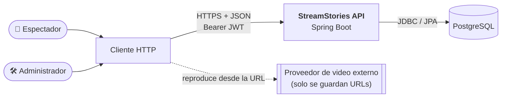
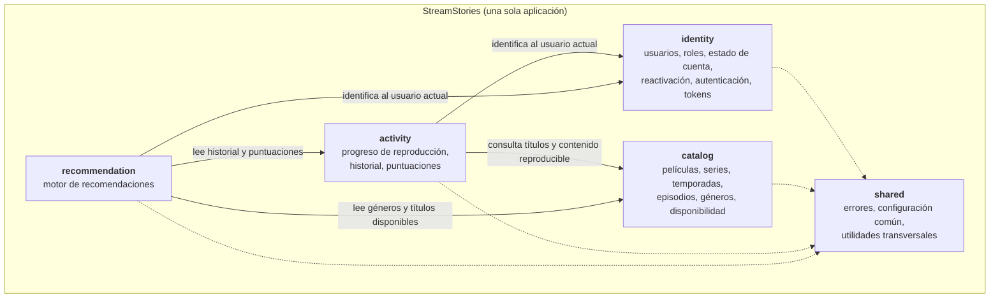
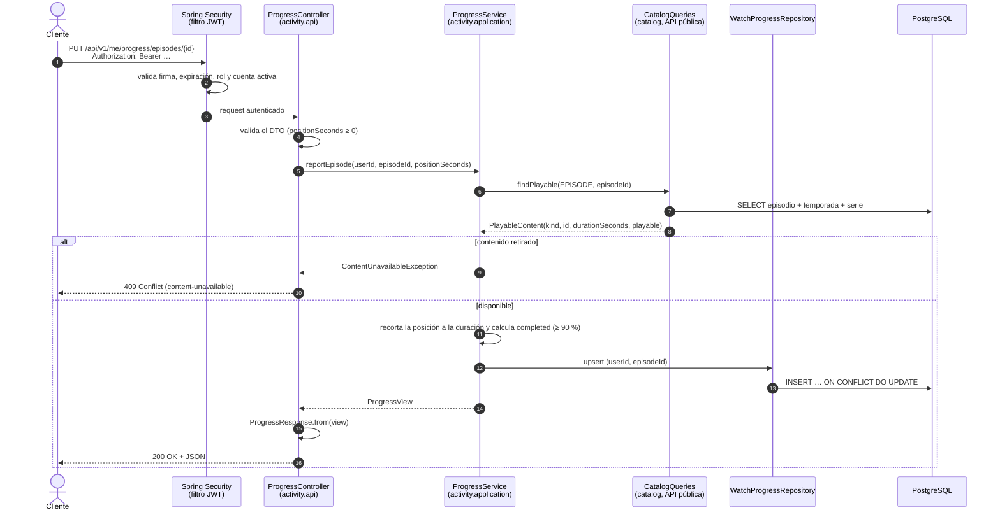

# 2. Arquitectura

## 2.1 Resumen

StreamStories es un **monolito modular**: una sola aplicación [Spring Boot](https://docs.spring.io/spring-boot/) que se despliega como una unidad. Por dentro está organizada en **módulos por funcionalidad**, con límites explícitos y verificados por tests ([ADR-0002](adr/0002-monolito-modular.md)).

Este enfoque tiene la simplicidad operativa de un monolito y, a la vez, mantiene el dominio bien separado. Si algún día hiciera falta, un módulo podría extraerse como servicio sin rediseñar el dominio.

## 2.2 Contexto del sistema



La API **no sirve video**. Guarda la URL y la duración de cada contenido reproducible. El cliente reproduce el video desde esa URL y le informa el progreso a la API ([ADR-0004](adr/0004-video-como-metadato.md)).

## 2.3 Stack tecnológico

| Área | Tecnología | Motivo |
|------|------------|--------|
| Lenguaje | [Java 25](https://openjdk.org/projects/jdk/25/) (LTS) | Versión de soporte extendido. Permite usar records, sealed types, pattern matching y virtual threads. |
| Framework | [Spring Boot 4](https://docs.spring.io/spring-boot/) | Es el estándar del backend Java y su ecosistema es maduro. |
| Web | [Spring Web MVC](https://docs.spring.io/spring-framework/reference/web/webmvc.html) | API REST síncrona. Con virtual threads no hace falta un stack reactivo. |
| Persistencia | [Spring Data JPA](https://docs.spring.io/spring-data/jpa/reference/) + [Hibernate](https://hibernate.org/orm/documentation/) | Mapeo objeto-relacional y repositorios declarativos. |
| Base de datos | [PostgreSQL](https://www.postgresql.org/docs/) | Base relacional robusta, con buen soporte de constraints e índices parciales. La búsqueda usa la extensión [`unaccent`](https://www.postgresql.org/docs/current/unaccent.html), que una migración crea (el dueño de la base puede hacerlo sin ser superusuario). |
| Migraciones | [Flyway](https://documentation.red-gate.com/flyway) | Esquema versionado en SQL y revisable en cada PR ([ADR-0006](adr/0006-migraciones-flyway.md)). |
| Validación | [Jakarta Bean Validation](https://beanvalidation.org/) | Validación declarativa de los DTO de entrada. |
| Seguridad | [Spring Security](https://docs.spring.io/spring-security/reference/) + [OAuth2 Resource Server (JWT)](https://docs.spring.io/spring-security/reference/servlet/oauth2/resource-server/jwt.html) | Validación estándar de JWT, sin librerías hechas a mano ([ADR-0005](adr/0005-autenticacion-jwt.md)). |
| Documentación de la API | [springdoc-openapi](https://springdoc.org/) | Genera la especificación OpenAPI 3 y Swagger UI a partir del código. |
| Modularidad | [Spring Modulith](https://docs.spring.io/spring-modulith/reference/) | Verifica en un test que ningún módulo viole sus límites. |
| Observabilidad | [Spring Boot Actuator](https://docs.spring.io/spring-boot/reference/actuator/index.html) | Health checks e información de la aplicación. |
| Testing | [JUnit 6](https://docs.junit.org/current/user-guide/), [AssertJ](https://assertj.github.io/doc/), [Mockito](https://site.mockito.org/), [Testcontainers](https://testcontainers.com/) | Tests de integración contra un PostgreSQL real. |
| Build | [Maven Wrapper](https://maven.apache.org/tools/wrapper/) | Compila sin necesidad de instalar Maven. |
| Entorno local | [Docker Compose](https://docs.docker.com/compose/) + [soporte de Spring Boot](https://docs.spring.io/spring-boot/reference/features/dev-services.html) | PostgreSQL se levanta solo al iniciar la aplicación. |
| CI | [GitHub Actions](https://docs.github.com/actions) | Build, tests y verificaciones en cada push y PR. |

## 2.4 Módulos



| Módulo | Responsabilidad | Depende de | Fase |
|--------|-----------------|------------|------|
| `identity` | Registro, login, tokens, roles, estado de cuenta, solicitudes de reactivación, configuración de seguridad | `shared` | 1 |
| `catalog` | ABM del catálogo, retiro de contenido, búsqueda y filtros por género o tipo | `shared` | 1 |
| `activity` | Progreso de reproducción, historial, "Seguir viendo", puntuaciones, lista de seguimiento | `catalog`, `identity`, `shared` | 2 |
| `recommendation` | Cálculo de recomendaciones personalizadas | `activity`, `catalog`, `identity`, `shared` | 3 |
| `shared` | Manejo global de errores (`ProblemDetail`), auditoría y tipos comunes | — | 1 |

**Reglas de dependencia:**

1. No hay ciclos: el grafo es dirigido y acíclico.
2. `catalog` **no conoce** a los usuarios ni su actividad. El catálogo existe aunque nadie lo mire.
3. Un módulo usa a otro **solo a través de su API pública**, formada por los tipos del paquete raíz del módulo. Nunca accede a entidades ni a repositorios internos de otro módulo.
4. Spring Modulith verifica estas reglas en un test (`ModularityTests`), y el build falla si alguna se rompe.

Ejemplo: para registrar el progreso de un episodio, `activity` no usa `EpisodeRepository`. Llama a `CatalogQueries.findPlayable(kind, id)`, una interfaz pública de `catalog` que devuelve un `PlayableContent` de solo lectura, con la duración y si el contenido se puede reproducir. Del mismo modo, toma el usuario actual del token con `identity.CurrentUser`.

Cuando `catalog` necesita saber algo de la actividad, se invierte la dependencia. Para no borrar contenido con actividad (regla C11), `catalog` publica la interfaz `ContentActivity`, que `activity` implementa. Lo mismo pasa con las puntuaciones que muestra el detalle de un título: `catalog` publica `TitleRatings` y `activity` la implementa. Así `catalog` sigue sin depender de nadie.

## 2.5 Estructura de paquetes

El código se organiza **por funcionalidad** (*package by feature*), no por capa técnica. Dentro de cada módulo se separan capas:

```
src/main/java/com/amillioncodelines/streamstories/
├── StreamstoriesApplication.java
├── catalog/
│   ├── ContentActivity.java         ← API pública: interfaz que implementan los módulos con actividad
│   ├── ContentKind.java
│   ├── CatalogQueries.java          ← API pública: consultas de solo lectura para otros módulos
│   ├── PlayableContent.java         ← y los resúmenes MovieSummary, EpisodeSummary y TitleSummary
│   ├── TitleRatings.java            ← API pública: puntuaciones para el detalle, las implementa activity
│   ├── RatingSummary.java
│   ├── api/                         ← entrada HTTP: controllers, DTO request/response
│   ├── application/                 ← casos de uso, transacciones, commands y views
│   └── domain/                      ← entidades JPA, enums, repositorios, consultas
├── identity/
│   ├── CurrentUser.java             ← API pública: el usuario actual, tomado del token
│   ├── api/  application/  domain/  ← application también emite los tokens (TokenIssuer)
│   └── security/                    ← SecurityFilterChain, validación del JWT, filtro de cuenta activa
├── activity/                        ← fase 2: implementa ContentActivity (C11) y TitleRatings
│   ├── ActivityQueries.java         ← API pública: actividad del usuario y promedios, para recommendation
│   └── api/  application/  domain/
├── recommendation/                  ← fase 3
│   ├── api/  application/
│   └── domain/                      ← RecommendationEngine: el algoritmo, sin Spring ni base de datos
└── shared/
    ├── error/                       ← @RestControllerAdvice → ProblemDetail
    ├── openapi/                     ← metadatos de la especificación y esquema de seguridad
    ├── persistence/                 ← entidad base auditada, configuración JPA
    ├── web/                         ← paginación (PageResponse, orden permitido, páginas en memoria)
    └── time/                        ← reloj de la aplicación (Clock), reemplazable en tests

src/main/resources/
├── application.yaml                 ← configuración común
├── application-dev.yaml             ← perfil de desarrollo local (clave JWT y administrador de desarrollo); no entra en el jar
├── application-prod.yaml            ← perfil productivo (logs estructurados)
├── db/migration/                    ← migraciones Flyway (V1__…, V2__…, …)
└── sample-data/catalog.json         ← catálogo de ejemplo que carga el perfil dev

src/test/java/com/amillioncodelines/streamstories/
├── ModularityTests.java             ← verificación de Spring Modulith
├── activity/ …                      ← misma estructura que main
├── recommendation/ …
├── catalog/ …
└── support/                         ← @IntegrationTest, Testcontainers y clientes de la API para tests
```

**Responsabilidades por capa:**

| Capa | Hace | No hace |
|------|------|---------|
| `api` | Recibe HTTP, valida el DTO, delega en `application` y convierte la respuesta | Lógica de negocio ni acceso a repositorios |
| `application` | Orquesta los casos de uso, define las transacciones (`@Transactional`) y aplica las reglas | Nada que dependa de HTTP |
| `domain` | Entidades con comportamiento e invariantes, y repositorios | Depender de otras capas |

**Tipos que cruzan las capas:**

- `api` define sus propios `record` de request (con Bean Validation) y de response, y los convierte desde y hacia `application`.
- `application` recibe valores simples o *commands* (`record` sin anotaciones de validación) y devuelve *views* de solo lectura. Nunca devuelve entidades.
- `api` puede usar enums y objetos de valor del dominio (`Role`, `Availability`, `CatalogFilter`), pero nunca entidades ni repositorios.

## 2.6 Decisiones transversales

| Tema | Decisión |
|------|----------|
| **DTO** | Las entidades JPA **nunca** se exponen en la API. Request y response son `record` de Java, con mapeo manual explícito. |
| **Errores** | Un `@RestControllerAdvice` global convierte las excepciones en [Problem Details (RFC 9457)](https://www.rfc-editor.org/rfc/rfc9457). Ver [API](04-api.md#47-errores). |
| **Transacciones** | `@Transactional` solo en la capa `application`. Las lecturas usan `readOnly = true`. |
| **Open Session in View** | Desactivado (`spring.jpa.open-in-view=false`). Evita consultas ocultas durante la serialización. |
| **Consultas N+1** | Las consultas que necesitan asociaciones las traen en la misma consulta con `@EntityGraph` o `JOIN FETCH` (por ejemplo, un episodio con su temporada y su serie). Las colecciones, como los géneros de cada título de una página, se cargan en lotes (`hibernate.default_batch_fetch_size`), porque un `JOIN FETCH` de colecciones obligaría a Hibernate a paginar en memoria. |
| **Identificadores** | `UUID` en todas las entidades expuestas, preferentemente ordenables en el tiempo (v7). No permiten adivinar recursos ajenos ni revelan volúmenes. |
| **Fechas** | `Instant` en Java y `timestamptz` en PostgreSQL, siempre en UTC. |
| **Auditoría** | `createdAt` y `updatedAt` automáticos, con [Spring Data JPA Auditing](https://docs.spring.io/spring-data/jpa/reference/auditing.html). |
| **Configuración** | `application.yaml` con perfiles: `dev` (lo activa `./mvnw spring-boot:run`), `test` (lo activa Maven al ejecutar los tests) y `prod`. Los secretos se reciben solo por variables de entorno; solo `dev` y `test` traen valores propios, que no sirven fuera de esos entornos. `application-dev.yaml` queda fuera del jar, así que la aplicación empaquetada no puede usar las credenciales de desarrollo aunque se active `dev` por error. Tampoco activa ningún perfil por defecto: sin la clave JWT no arranca. |
| **Virtual threads** | Activados (`spring.threads.virtual.enabled=true`): dan alta concurrencia con código bloqueante simple ([JEP 444](https://openjdk.org/jeps/444)). |
| **Logs** | Formato estructurado JSON ([ECS](https://docs.spring.io/spring-boot/reference/features/logging.html#features.logging.structured)) en el perfil `prod`. Nunca se loguean contraseñas ni tokens. |

## 2.7 Ejemplo de flujo: registrar el progreso de un episodio


