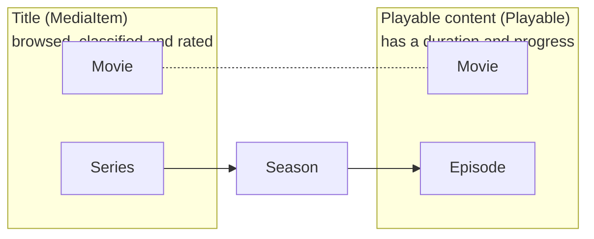
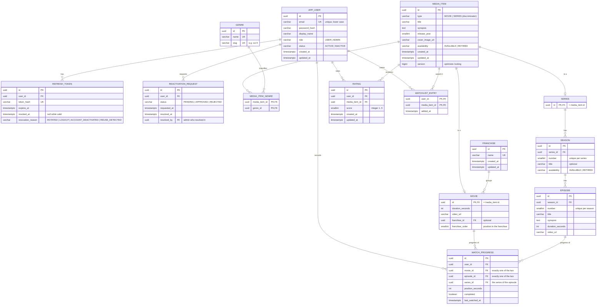

# 3. Domain model and data

## 3.1 Key concepts

The domain has two hierarchies that cross each other:



- **`Movie`** is a title and also playable content.
- **`Series`** is a title, but it is not played directly.
- **`Episode`** is playable, but it is not a title: it has no genres or ratings of its own, because they belong to its series.

Two rules follow from this distinction: **genres and ratings belong to titles**, and **progress is recorded on playable content**.

## 3.2 Entity-relationship diagram



The `login_attempt` table, which counts failed password checks, is described in [Security](05-security.md#login-attempt-limit).

## 3.3 Modeling decisions

### `MediaItem` inheritance: the `JOINED` strategy

`MediaItem` is an abstract entity with two subclasses (`Movie` and `Series`), mapped with [`JOINED` inheritance](https://docs.jboss.org/hibernate/orm/current/userguide/html_single/Hibernate_User_Guide.html#entity-inheritance-joined-table) ([ADR-0007](adr/0007-inheritance-and-progress-model.md)).

- The `media_item` table holds what they have in common. That way a single query returns the **mixed catalog**: movies and series together, filtered by genre.
- Each subtype has its own table, and its required columns can be declared `NOT NULL`.

### Progress: two exclusive foreign keys

`WATCH_PROGRESS` points to a movie **or** an episode through two nullable foreign key columns, with this constraint:

```sql
CHECK ((movie_id IS NOT NULL) <> (episode_id IS NOT NULL))
```

There are also two partial unique indexes: `(user_id, movie_id)` and `(user_id, episode_id)`. With this design the database guarantees referential integrity, which a polymorphic reference (`content_type` + `content_id`) cannot.

The progress of an episode also stores its series (`series_id`). It is derived data, because an episode never changes season. It lets "continue watching" find the last episode of each series with a single query on the `activity` module's own table, without loading everything the user watched.

### Availability instead of deletion

Content that stops being offered is not deleted: its `availability` changes to `RETIRED` ([ADR-0011](adr/0011-retiring-by-season.md)). Availability lives in `media_item` (whole movies and series) and in `season` (whole seasons). Episodes are not retired one by one.

Content is **playable** when:
- **Movie:** its `availability` is `AVAILABLE`.
- **Episode:** its season **and** its series have `availability = AVAILABLE`.

### Spanish alphabetical order

Titles, genre names and season and episode titles use the ICU collation `es-x-icu`. The catalog content is in Spanish, so the order respects accents and ñ ("Nube", "Ñandú", "Órbita") without depending on the locale of the operating system that runs PostgreSQL.

### User and account are the same entity

Since an account belongs to a single viewer, `User` and `Account` are the same entity, with its `AccountStatus`. The table is called `app_user` because `user` is a reserved word in PostgreSQL.

### Reactivation is an entity of its own

Each reactivation request is a `REACTIVATION_REQUEST` row with its resolution (who resolved it and when). That keeps a trace of every request and every decision ([ADR-0010](adr/0010-admin-approved-reactivation.md)). A partial unique index guarantees that each user has at most **one** `PENDING` request.

### One role per user

`role` is an enum column (`USER` | `ADMIN`), not a many-to-many relation: two exclusive roles are enough.

## 3.4 Business rules

### Catalog

| # | Rule | Enforced by |
|---|------|-------------|
| C1 | Every title has a non-empty `title`. | Bean Validation + `NOT NULL` |
| C2 | A title has 0 to N genres, without repeats. | Composite PK in `media_item_genre` |
| C3 | A genre's name and slug are unique, ignoring case. | Unique index on `lower(name)` |
| C4 | A season number is unique within its series and goes from 1 to 999. | `UNIQUE (series_id, number)` + `CHECK` |
| C5 | An episode number is unique within its season and goes from 1 to 999. | `UNIQUE (season_id, number)` + `CHECK` |
| C6 | Movies and episodes have a duration greater than 0. | `CHECK` + validation |
| C7 | A series can exist without seasons, for example while it is being loaded. | — |
| C8 | A genre with titles cannot be deleted. | Service → `409 Conflict` |
| C9 | Retired content does not appear in the listings, searches or series details that a `USER` sees, but it is still reachable by id (a season, by its number), showing its `availability`. An `ADMIN` sees everything. | Service queries |
| C10 | Retiring content does not change or delete any related data: progress, ratings or watchlists. | Design (no cascades) |
| C11 | Only content without any related activity (progress, ratings or watchlist entries) can be **deleted**, for example content loaded by mistake. Content with activity must be retired. A season can only be deleted if it has no episodes. | Service → `409 Conflict`, through the `ContentActivity` interface |
| C12 | Retired content can be made available again. | — |
| C13 | A franchise's name is unique, ignoring case. | Unique index on `lower(name)` |
| C14 | A franchise only groups movies, in the order they are given, and each movie belongs to one franchise at most. | FK in `movie` + `UNIQUE (franchise_id, franchise_order)` |
| C15 | Deleting a franchise does not delete its movies: it only releases them. A `USER` does not see the retired movies of a franchise; an `ADMIN` sees them all. | Service |

### Identity

| # | Rule |
|---|------|
| I1 | The email is unique and stored normalized (lower case, without spaces). |
| I2 | The password is only stored as a hash. It is never returned or logged. |
| I3 | An `INACTIVE` account cannot authenticate or use the API. The only thing it can do is request reactivation. |
| I4 | The account holder or an `ADMIN` can deactivate an account. Deactivating it revokes all its refresh tokens. |
| I5 | **Only an `ADMIN` can reactivate an account**: by approving a request, or directly from user administration. |
| I6 | An inactive user has at most one `PENDING` reactivation request. Asking again returns the existing one. |
| I7 | Deactivating an account **does not delete** its progress or ratings. Once reactivated, everything is available again. |
| I8 | Sign-up always creates a `USER`. An `ADMIN` is created on startup or promoted by another admin. |
| I9 | The last active `ADMIN` cannot be deactivated or demoted. |
| I10 | After 5 wrong passwords for an email within 15 minutes, login and reactivation for that email are blocked until the window ends, whether the account exists or not. |

### Activity

| # | Rule |
|---|------|
| A1 | There is a single progress record per (user, playable content). Each progress report updates that record (upsert) and its date. |
| A2 | `0 ≤ position_seconds ≤ duration_seconds`. A larger value is capped at the duration. If the duration changes later, the saved progress is not recalculated: completed content stays completed, and the position is capped when shown. |
| A3 | The **exact position** reported is always saved, and only the latest one: each viewing is not stored. Content is marked `completed` when the position reaches **90%** of the duration, and stays completed even if a shorter position is reported later (for example, when watching it again). |
| A4 | Progress cannot be reported on content that is not playable (retired): the API answers `409`. Progress already saved is kept. |
| A5 | **Continue watching**, for movies: the ones not completed appear, with their saved position. |
| A6 | **Continue watching**, for series: there is **one entry per series**, with the most recently watched episode, its position and whether it is completed. The next episode is not calculated: from the series, the user chooses where to continue. The series leaves once that episode is completed and no playable episode follows it, because it was the last one or because the following seasons are retired. |
| A7 | Continue watching is ordered by `last_watched_at` descending and leaves out retired movies and series. An available series appears even if its last watched episode is in a retired season. |
| A8 | The history shows all recorded progress: one row per movie or episode, with the date it was last watched. It includes retired content, marked as such. |
| A9 | There is a single rating per (user, title), and rating again replaces it. |
| A10 | A rating is an **integer from 1 to 5**. Only titles (movies and series) are rated, never single episodes. |
| A11 | A title's average is computed over all its ratings, including those of deactivated accounts, and shown with one decimal (for example, `4.3`). |
| A12 | A title can be rated without being watched. A rating cannot be created or changed on a retired title, but it can be deleted. Existing ratings are kept and still count for the average. |
| A13 | The watchlist holds movies and series, never single episodes, each at most once. Adding a title again does not change its date. |
| A14 | A retired title cannot be added. One retired after being added stays in the list, marked as not available, and can be removed. |

## 3.5 Recommendation engine (phase 3)

It is a **content-based** approach: simple, explainable and testable.

1. **User signals.** Each title the user rated or completed gives a signal:
   - a score of 4 or 5 → +2; a score of 1 or 2 → −2; a score of 3 is neutral;
   - completed title → +1. A movie counts when it is completed, and a series when at least one of its episodes is completed. Each title counts once, however many episodes were watched.

   Retired titles give signals too: they still show what the user likes, even though they are never recommended.
2. **Genre affinity.** Each title's signal is added to each of its genres.
3. **Candidates.** **Available** titles with at least one genre of positive affinity, that the user **neither rated nor started**. A series counts as started if any of its episodes has progress.
4. **Candidate score.** The sum of the affinities of its genres, plus **0.5** if it is in the favorite format: movie or series, whichever has more titles with a positive signal. If both formats tie, there is no adjustment.
5. **Order.** By score; on equal scores, by community average (titles without ratings go last), then by number of ratings, then newest first and, finally, by title.
6. **No candidates.** A new user, or one without positive affinities, or one who has seen everything in their genres, gets the available titles they have neither watched nor rated, ordered by community average, number of ratings and newest first. That way the list is never empty while there is a catalog.
7. **Explainability.** Each recommendation includes its reason (`reason`):
   - with candidates, the two genres of the title that the user likes most: `"Because you like Drama and Comedia"`;
   - without candidates, `"Top rated by other viewers"`, or `"New on StreamStories"` if the title has no ratings.

It is computed on each request, without a cache ([ADR-0012](adr/0012-measured-performance-without-cache.md)).
