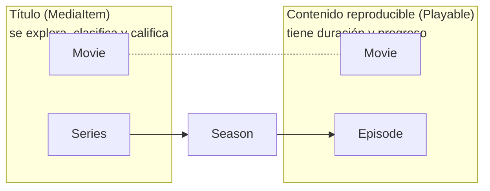

# 3. Modelo de dominio y datos

## 3.1 Conceptos clave

El dominio tiene dos jerarquías que se cruzan:



- **`Movie`** es título y además contenido reproducible.
- **`Series`** es título, pero no se reproduce directamente.
- **`Episode`** es reproducible, pero no es título: no tiene géneros ni puntuación propios, porque los hereda de su serie.

De esta distinción salen dos reglas: **los géneros y las puntuaciones se asignan a títulos** y **el progreso se registra sobre contenido reproducible**.

## 3.2 Diagrama entidad-relación

```mermaid
erDiagram
    APP_USER {
        uuid id PK
        varchar email UK "único, en minúsculas"
        varchar password_hash
        varchar display_name
        varchar role "USER | ADMIN"
        varchar status "ACTIVE | INACTIVE"
        timestamptz created_at
        timestamptz updated_at
    }
    REFRESH_TOKEN {
        uuid id PK
        uuid user_id FK
        varchar token_hash UK
        timestamptz expires_at
        timestamptz revoked_at "null si está vigente"
    }
    REACTIVATION_REQUEST {
        uuid id PK
        uuid user_id FK
        varchar status "PENDING | APPROVED | REJECTED"
        timestamptz requested_at
        timestamptz resolved_at
        uuid resolved_by FK "admin que resolvió"
    }

    GENRE {
        uuid id PK
        varchar name UK
        varchar slug UK "p. ej. sci-fi"
    }
    MEDIA_ITEM {
        uuid id PK
        varchar type "MOVIE | SERIES (discriminador)"
        varchar title
        text synopsis
        smallint release_year
        varchar cover_image_url
        varchar availability "AVAILABLE | RETIRED"
        timestamptz created_at
        timestamptz updated_at
    }
    MEDIA_ITEM_GENRE {
        uuid media_item_id PK, FK
        uuid genre_id PK, FK
    }
    MOVIE {
        uuid id PK, FK "= media_item.id"
        int duration_seconds
        varchar video_url
        uuid franchise_id FK "opcional (fase 4)"
        smallint franchise_order "opcional (fase 4)"
    }
    SERIES {
        uuid id PK, FK "= media_item.id"
    }
    SEASON {
        uuid id PK
        uuid series_id FK
        smallint number "único por serie"
        varchar title "opcional"
    }
    EPISODE {
        uuid id PK
        uuid season_id FK
        smallint number "único por temporada"
        varchar title
        text synopsis
        int duration_seconds
        varchar video_url
        varchar availability "AVAILABLE | RETIRED"
    }

    WATCH_PROGRESS {
        uuid id PK
        uuid user_id FK
        uuid movie_id FK "exactamente uno de los dos"
        uuid episode_id FK "exactamente uno de los dos"
        int position_seconds
        boolean completed
        timestamptz last_watched_at
    }
    RATING {
        uuid id PK
        uuid user_id FK
        uuid media_item_id FK
        smallint score "entero 1..5"
        timestamptz created_at
        timestamptz updated_at
    }

    FRANCHISE {
        uuid id PK
        varchar name UK
    }
    WATCHLIST_ENTRY {
        uuid user_id PK, FK
        uuid media_item_id PK, FK
        timestamptz added_at
    }

    APP_USER ||--o{ REFRESH_TOKEN : "tiene"
    APP_USER ||--o{ REACTIVATION_REQUEST : "solicita"
    MEDIA_ITEM ||--o| MOVIE : "es una"
    MEDIA_ITEM ||--o| SERIES : "es una"
    MEDIA_ITEM ||--o{ MEDIA_ITEM_GENRE : "clasificado en"
    GENRE ||--o{ MEDIA_ITEM_GENRE : "clasifica"
    SERIES ||--o{ SEASON : "tiene"
    SEASON ||--o{ EPISODE : "tiene"
    APP_USER ||--o{ WATCH_PROGRESS : "registra"
    MOVIE ||--o{ WATCH_PROGRESS : "progreso de"
    EPISODE ||--o{ WATCH_PROGRESS : "progreso de"
    APP_USER ||--o{ RATING : "califica"
    MEDIA_ITEM ||--o{ RATING : "recibe"
    FRANCHISE ||--o{ MOVIE : "agrupa"
    APP_USER ||--o{ WATCHLIST_ENTRY : "guarda"
    MEDIA_ITEM ||--o{ WATCHLIST_ENTRY : "guardado en"
```



`FRANCHISE` y `WATCHLIST_ENTRY` se incorporan en la fase 4. El resto forma el núcleo de las fases 1 a 3.

## 3.3 Decisiones de modelado

### Herencia de `MediaItem`: estrategia `JOINED`

`MediaItem` es una entidad abstracta con dos subclases (`Movie` y `Series`), mapeada con [herencia `JOINED`](https://docs.jboss.org/hibernate/orm/current/userguide/html_single/Hibernate_User_Guide.html#entity-inheritance-joined-table) ([ADR-0007](adr/0007-modelo-herencia-y-progreso.md)).

- La tabla `media_item` contiene lo común. Así, una única consulta devuelve el **catálogo mixto**: películas y series juntas, filtradas por género.
- Cada subtipo tiene su propia tabla, y sus columnas obligatorias pueden declararse `NOT NULL`.

### Progreso: dos FK excluyentes

`WATCH_PROGRESS` apunta a una película **o** a un episodio mediante dos columnas FK que admiten nulos, con esta restricción:

```sql
CHECK ((movie_id IS NOT NULL) <> (episode_id IS NOT NULL))
```

Además hay dos índices únicos parciales: `(user_id, movie_id)` y `(user_id, episode_id)`. Con este diseño, la base de datos garantiza la integridad referencial, algo que una referencia polimórfica (`content_type` + `content_id`) no permite.

### Disponibilidad en lugar de borrado

El contenido que deja de ofrecerse no se borra: cambia su `availability` a `RETIRED` ([ADR-0009](adr/0009-retiro-de-contenido.md)). La disponibilidad está en `media_item` (películas y series completas) y en `episode` (episodios sueltos).

Un contenido es **reproducible** si:
- **Película:** `movie.availability = AVAILABLE`.
- **Episodio:** `episode.availability = AVAILABLE` **y** su serie tiene `availability = AVAILABLE`.

### Usuario y cuenta son la misma entidad

Como una cuenta corresponde a un único espectador, `User` y `Account` son la misma entidad, con su `AccountStatus`. La tabla se llama `app_user` porque `user` es una palabra reservada en PostgreSQL.

### La reactivación es una entidad propia

Cada pedido de reactivación es un registro de `REACTIVATION_REQUEST` con su resolución (quién la resolvió y cuándo). Así queda trazabilidad de cada pedido y de cada decisión ([ADR-0010](adr/0010-reactivacion-aprobada-por-admin.md)). Un índice único parcial garantiza que cada usuario tenga como máximo **una** solicitud `PENDING`.

### Un rol por usuario

`role` es una columna enum (`USER` | `ADMIN`) y no una relación muchos a muchos: con dos roles excluyentes alcanza.

## 3.4 Reglas de negocio

### Catálogo

| # | Regla | Dónde se garantiza |
|---|-------|--------------------|
| C1 | Todo título tiene `title` no vacío. | Bean Validation + `NOT NULL` |
| C2 | Un título tiene de 0 a N géneros, sin repetir. | PK compuesta en `media_item_genre` |
| C3 | El nombre y el slug de un género son únicos, sin distinguir mayúsculas. | Índice único sobre `lower(name)` |
| C4 | El número de temporada es único dentro de su serie y empieza en 1. | `UNIQUE (series_id, number)` + `CHECK` |
| C5 | El número de episodio es único dentro de su temporada y empieza en 1. | `UNIQUE (season_id, number)` + `CHECK` |
| C6 | Películas y episodios tienen una duración mayor que 0. | `CHECK` + validación |
| C7 | Una serie puede existir sin temporadas, por ejemplo mientras se carga. | — |
| C8 | Un género con títulos asociados no se puede borrar. | Servicio → `409 Conflict` |
| C9 | El contenido retirado no aparece en los listados, búsquedas ni detalles de serie que ve un `USER`, pero sigue siendo accesible por ID, indicando su `availability`. Un `ADMIN` ve todo. | Consultas del servicio |
| C10 | Retirar contenido no modifica ni borra ningún dato relacionado: progreso, puntuaciones ni listas de seguimiento. | Diseño (no hay cascadas) |
| C11 | Solo se puede **borrar** un contenido que no tiene ninguna actividad asociada, por ejemplo uno cargado por error. Si tiene actividad, hay que retirarlo. Una temporada solo se borra si no tiene episodios. | Servicio → `409 Conflict`, consultando la interfaz `ContentActivity` |
| C12 | Un contenido retirado puede volver a estar disponible. | — |

### Identidad

| # | Regla |
|---|-------|
| I1 | El email es único y se guarda normalizado (minúsculas y sin espacios). |
| I2 | La contraseña se guarda solo como hash. Nunca se devuelve ni se loguea. |
| I3 | Una cuenta `INACTIVE` no puede autenticarse ni usar la API. Lo único que puede hacer es solicitar la reactivación. |
| I4 | La cuenta la puede desactivar su titular o un `ADMIN`. Al desactivarla se revocan todos sus refresh tokens. |
| I5 | **Solo un `ADMIN` puede reactivar una cuenta**: aprobando una solicitud o directamente desde la gestión de usuarios. |
| I6 | Un usuario inactivo tiene como máximo una solicitud de reactivación `PENDING`. Si vuelve a pedirla, se reutiliza la existente. |
| I7 | Desactivar una cuenta **no borra** progreso ni puntuaciones. Al reactivarla, todo vuelve a estar disponible. |
| I8 | El registro siempre crea un `USER`. Un `ADMIN` se crea al iniciar el sistema o por promoción de otro admin. |
| I9 | No se puede desactivar ni degradar al último `ADMIN` activo. |

### Actividad

| # | Regla |
|---|-------|
| A1 | Hay un único registro de progreso por (usuario, contenido reproducible). Cada reporte de progreso actualiza ese registro (upsert) y su fecha. |
| A2 | `0 ≤ position_seconds ≤ duration_seconds`. Un valor mayor se recorta a la duración. |
| A3 | Siempre se guarda la **posición exacta** reportada. El contenido se marca `completed` cuando la posición alcanza el **90 %** de la duración, y sigue completo aunque luego se reporte una posición menor (por ejemplo, al volver a verlo). |
| A4 | No se puede reportar progreso sobre contenido no reproducible (retirado): la API responde `409`. |
| A5 | **Seguir viendo**, para películas: aparecen las no completadas, con su posición guardada. |
| A6 | **Seguir viendo**, para series: aparece **una entrada por serie**, basada en el episodio visto más recientemente. Si ese episodio **no está completo**, la entrada es ese mismo episodio en su posición guardada. Si está completo, la entrada es el **siguiente episodio reproducible** desde el inicio, que puede ser de la temporada siguiente. Si no hay siguiente, la serie no aparece. |
| A7 | Seguir viendo está ordenado por `last_watched_at` descendente y excluye el contenido retirado. |
| A8 | El historial muestra todo el progreso registrado, incluido el de contenido retirado, que aparece marcado como tal. |
| A9 | Hay una única puntuación por (usuario, título), y volver a puntuar la reemplaza. |
| A10 | La puntuación es un **entero de 1 a 5**. Solo se califican títulos (películas y series), nunca episodios sueltos. |
| A11 | El promedio de un título se calcula sobre todas sus puntuaciones y se expresa con un decimal (por ejemplo, `4.3`). |
| A12 | Se puede calificar un título que no se vio. No se pueden crear puntuaciones nuevas sobre títulos retirados, pero las existentes se conservan y siguen contando para el promedio. |

## 3.5 Motor de recomendaciones (fase 3)

Es un enfoque **basado en contenido**: simple, explicable y testeable.

1. **Afinidad por género.** Para cada género se suman señales del usuario:
   - puntuación de 4 o 5 → +2 por título; puntuación de 1 o 2 → −2;
   - película o episodio completado → +1 para el título correspondiente.
2. **Candidatos.** Títulos **disponibles**, con al menos un género de afinidad positiva, que el usuario **no calificó ni empezó a ver**.
3. **Puntaje del candidato.** Suma de las afinidades de sus géneros, más un ajuste menor por el formato preferido (película o serie).
4. **Usuarios sin actividad.** Reciben los títulos disponibles mejor calificados por la comunidad.
5. **Explicabilidad.** Cada recomendación incluye su motivo, por ejemplo `"Porque te gustan Sci-Fi y Action"`.

El cálculo se hace al momento de la consulta. Si el volumen de datos lo requiere, se puede cachear o precalcular en la fase 4.
