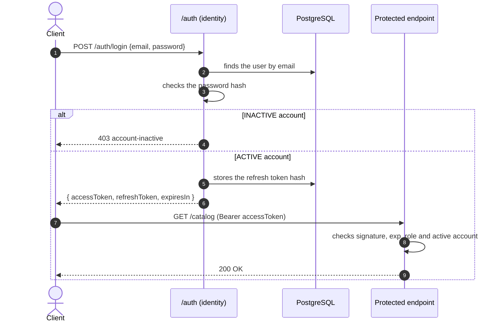
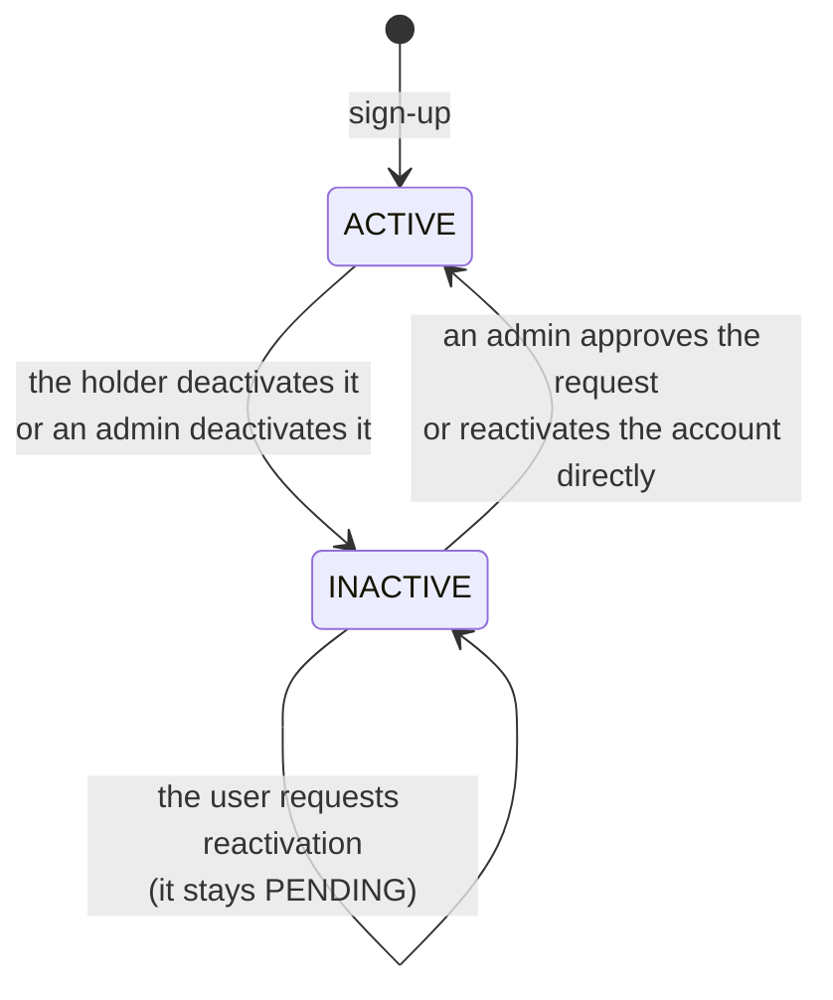

# 5. Security

## 5.1 Authentication model

The API is **stateless**: the server keeps no sessions. Each request is authenticated with a **JWT access token** in the `Authorization: Bearer <token>` header ([ADR-0005](adr/0005-jwt-authentication.md)).

| Token | Format | Lifetime | Storage | Use |
|-------|--------|----------|---------|-----|
| **Access token** | Signed [JWT](https://datatracker.ietf.org/doc/html/rfc7519) (HS256) | 15 minutes | Only on the client | Authenticate each request |
| **Refresh token** | Opaque random 256-bit value | 7 days | On the client. The database only stores its **hash** | Get a new access token without logging in again |

**Access token claims:** `sub` (the user's UUID), `role`, `iat`, `exp`, `iss`. It carries no personal data.

**Implementation:** the access token is validated with the standard support of [Spring Security OAuth2 Resource Server](https://docs.spring.io/spring-security/reference/servlet/oauth2/resource-server/jwt.html) (`NimbusJwtDecoder`). No custom validation filters or libraries are used.

## 5.2 Flows

### Login and API use

### Login attempt limit

After **5 wrong passwords** for the same email within **15 minutes**, login and reactivation requests for that email answer `429 too-many-requests` with a `Retry-After` header until the window ends. While the block lasts, the right password is not accepted either. A successful login before reaching the limit resets the count.

- **Persistent and atomic:** attempts are stored in the database (`login_attempt`), so the limit holds even with several application instances. Each attempt is counted in one statement before the password is checked, so simultaneous attempts cannot check more than 5 passwords either.
- **Without revealing emails:** emails without an account are counted too. If only real accounts were blocked, the `429` would reveal which emails exist. That is also why the table does not store the email but an HMAC of it, computed with the server key.
- **Accepted cost:** anyone can block the login of someone else's email for 15 minutes. That is preferred to limiting by IP, which is unreliable behind a proxy.
- A daily task deletes the attempts of finished windows.

### Refresh with rotation

1. The client sends its refresh token to `POST /auth/refresh`.
2. The server looks up its hash. If the token is unexpired, not revoked and the user is still `ACTIVE`, it **revokes that token** (reason: rotated) and issues a new pair.
3. **Reuse detection:** if a refresh token arrives that had already been **rotated**, it may have been stolen, so **every** refresh token of the user is revoked.
4. A token that expired, or that was revoked by a logout or an account deactivation, is only rejected with `401`. If the account is inactive, the refresh also answers the same generic `401`: only login and reactivation, which receive the password, report `account-inactive`. That way an old client retrying with an invalid token does not close the user's active sessions.

Each revocation stores its reason (`ROTATED`, `LOGOUT`, `ACCOUNT_DEACTIVATED`, `REUSE_DETECTED`), which is what tells these cases apart.

Expired refresh tokens are deleted once a day. Until they expire they are kept, even if revoked, because a rotated token is what detects reuse.

### Account lifecycle

While the account is inactive:

- all its refresh tokens are revoked;
- its history and ratings are kept intact;
- login answers `403 account-inactive` if the credentials are correct;
- the user can create a reactivation request with `POST /auth/reactivation-requests`, sending their credentials. If one is already pending, that same one is returned;
- an `ADMIN` reviews the pending requests and approves or rejects them. Once one is approved, the account is `ACTIVE` again and the user can log in as usual.

**Account changes apply immediately.** An access token issued before the account was deactivated stays cryptographically valid until it expires (15 minutes at most). For the deactivation to apply at once, a filter checks on each request that the user is still `ACTIVE`. The same filter takes the **current** role from the database, not the one in the token, so promoting or demoting a user also applies immediately. It is a lightweight query per request, which could be cached for a few seconds if needed.

## 5.3 Authorization

| Role | Permissions |
|------|-------------|
| Anonymous | Sign up, log in, refresh the token, request reactivation. Read `/actuator/health`, `/actuator/info` (application name and version) and the API documentation. |
| `USER` | Read the available catalog and manage **their own** activity, ratings and account. |
| `ADMIN` | Everything a `USER` can do, plus managing the catalog, the users and the reactivation requests. |

- Rules by route and method are declared in the `SecurityFilterChain`. Rules finer than the route (for example, by resource owner) are resolved in the service.
- **Deny by default:** every endpoint not explicitly listed requires authentication.
- The public authentication endpoints (sign-up, login, refresh and reactivation requests) ignore the `Authorization` header. Clients often attach the access token to every request, and an expired token must not block a refresh, nor an inactive account's reactivation request.
- The user's resources are **always** resolved from the token (`/me/...`). That prevents [access to other people's data by manipulating identifiers (IDOR)](https://owasp.org/www-community/attacks/Insecure_Direct_Object_Reference).
- A test matrix calls each protected endpoint without a token (401) and, for administration endpoints, with the `USER` role (403). The authorized path of each endpoint is covered by its feature's tests.

## 5.4 Security practices

| Area | Practice |
|------|----------|
| Passwords | Hashed with BCrypt through [`DelegatingPasswordEncoder`](https://docs.spring.io/spring-security/reference/features/authentication/password-storage.html), which allows migrating to another algorithm. Length: 8 characters to 72 bytes, the maximum BCrypt processes. |
| Secrets | The JWT signing key (`STREAMSTORIES_SECURITY_JWT_SECRET`, at least 32 characters) and the database credentials only come from environment variables. Outside the development profile there are no defaults: without the key, the application does not start. `.env` files are not versioned. |
| Brute force | A limit of wrong passwords per email (see §5.2, "Login attempt limit"). |
| CORS | Disabled by default. Enabled with an explicit list of origins if needed. |
| CSRF | Disabled: authentication goes in a `Bearer` header, not in session cookies ([reference](https://docs.spring.io/spring-security/reference/features/exploits/csrf.html#csrf-when)). |
| Actuator | Only `health` and `info` are exposed. |
| Headers | Spring Security's [default security headers](https://docs.spring.io/spring-security/reference/features/exploits/headers.html) are used. |
| Errors | They include no stack traces. Login and reactivation requests do not reveal whether an email exists: when it does not, the password is still checked against a dummy hash, so the response time does not give it away either. Sign-up does report a duplicate email (`409`), because the user needs to know why it fails. |
| Dependencies | [Dependabot](https://docs.github.com/code-security/dependabot) keeps the updates and the vulnerability alerts. |
| Logs | Passwords, tokens and the `Authorization` header are never logged. |

These practices follow the recommendations of the [OWASP API Security Top 10](https://owasp.org/API-Security/).

## 5.5 Initial administrator

The first `ADMIN` is created on startup if none exists yet, with the email and password from the `STREAMSTORIES_ADMIN_EMAIL` and `STREAMSTORIES_ADMIN_PASSWORD` environment variables. If they are not set, no administrator is created and a warning is logged. The password follows the same rules as sign-up (8 characters to 72 bytes) and cannot be `change-me`, the placeholder used in `.env.example`: otherwise, the application does not start. **There are no default credentials.**

The only exception is the `dev` profile, which only `./mvnw spring-boot:run` enables: it defines a development administrator (`admin@streamstories.local`) to explore the API on a local database. Its configuration is not in the jar, so the packaged application cannot use it.
