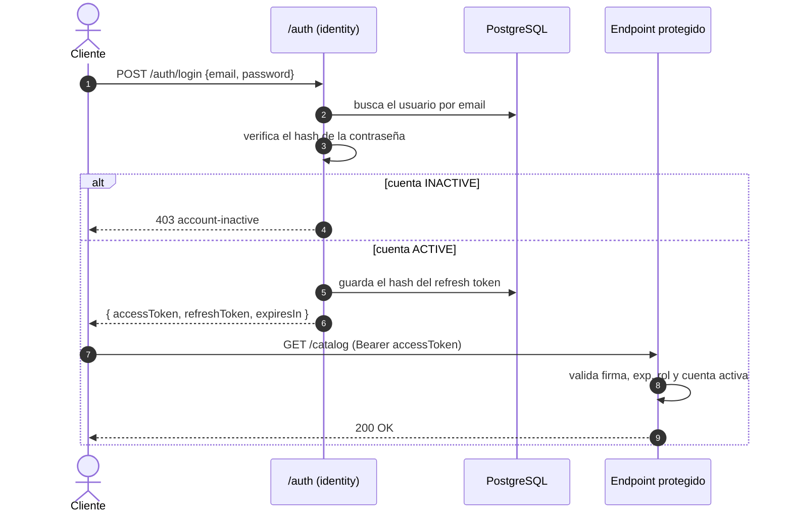
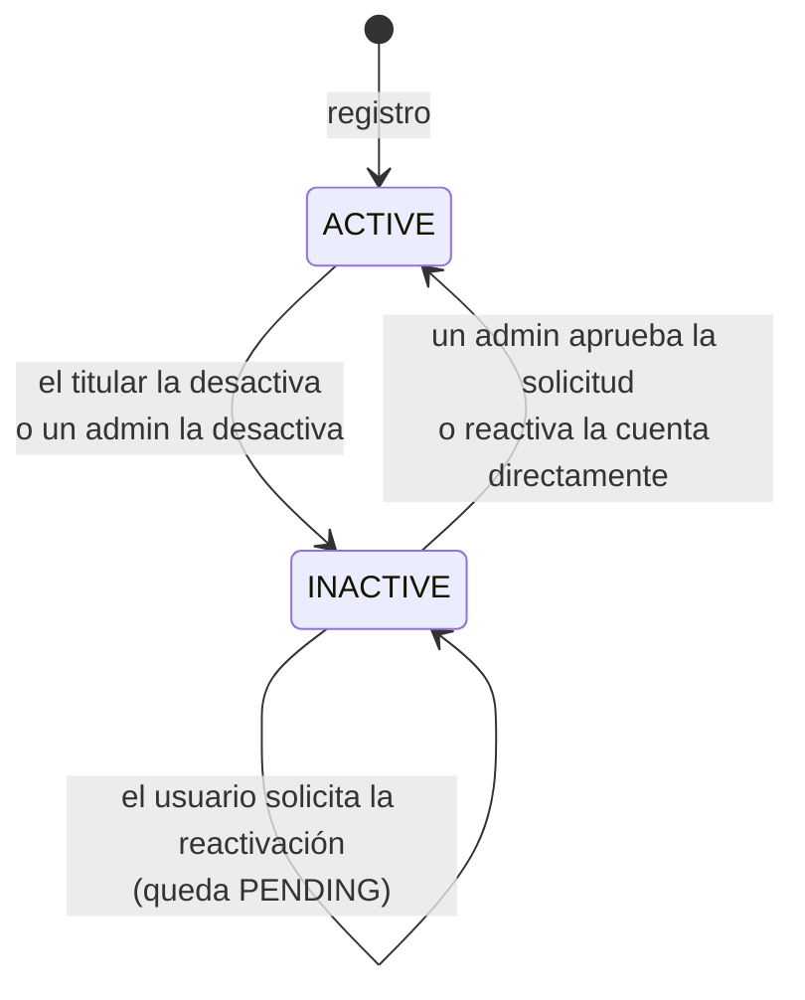

# 5. Seguridad

## 5.1 Modelo de autenticación

La API es **stateless**: el servidor no guarda sesiones. Cada request se autentica con un **access token JWT** en el header `Authorization: Bearer <token>` ([ADR-0005](adr/0005-autenticacion-jwt.md)).

| Token | Formato | Vida útil | Almacenamiento | Uso |
|-------|---------|-----------|----------------|-----|
| **Access token** | [JWT](https://datatracker.ietf.org/doc/html/rfc7519) firmado (HS256) | 15 minutos | Solo en el cliente | Autenticar cada request |
| **Refresh token** | Valor aleatorio opaco de 256 bits | 7 días | En el cliente. En la base solo se guarda su **hash** | Obtener un nuevo access token sin volver a iniciar sesión |

**Claims del access token:** `sub` (UUID del usuario), `role`, `iat`, `exp`, `iss`. No incluye datos personales.

**Implementación:** el access token se valida con el soporte estándar de [Spring Security OAuth2 Resource Server](https://docs.spring.io/spring-security/reference/servlet/oauth2/resource-server/jwt.html) (`NimbusJwtDecoder`). No se usan filtros ni librerías de validación propios.

## 5.2 Flujos

### Login y uso de la API

### Renovación con rotación

1. El cliente envía su refresh token a `POST /auth/refresh`.
2. El servidor busca su hash. Si el token está vigente, no fue revocado y el usuario sigue `ACTIVE`, **revoca ese token** (motivo: rotado) y emite un par nuevo.
3. **Detección de reutilización:** si llega un refresh token que ya había sido **rotado**, se asume que pudo ser robado y se revocan **todos** los refresh tokens del usuario.
4. Un token vencido, o revocado por logout o por desactivación de la cuenta, solo se rechaza con `401`. Si la cuenta está inactiva, el refresh también responde el mismo `401` genérico: `account-inactive` solo lo informan el login y la reactivación, que reciben la contraseña. Así, un cliente viejo que reintenta con un token inválido no cierra las sesiones vigentes del usuario.

Cada revocación guarda su motivo (`ROTATED`, `LOGOUT`, `ACCOUNT_DEACTIVATED`, `REUSE_DETECTED`), que es lo que permite distinguir estos casos.

### Ciclo de vida de una cuenta

Mientras la cuenta está inactiva:

- se revocan todos sus refresh tokens;
- se conservan intactos el historial y las puntuaciones;
- el login devuelve `403 account-inactive` si las credenciales son correctas;
- el usuario puede crear una solicitud de reactivación con `POST /auth/reactivation-requests`, enviando sus credenciales. Si ya hay una pendiente, se devuelve esa misma;
- un `ADMIN` revisa las solicitudes pendientes y las aprueba o las rechaza. Al aprobar una, la cuenta vuelve a `ACTIVE` y el usuario puede iniciar sesión normalmente.

**Efecto inmediato de los cambios de cuenta.** Un access token emitido antes de desactivar la cuenta sigue siendo criptográficamente válido hasta que vence (como máximo 15 minutos). Para que la desactivación se aplique en el momento, un filtro verifica en cada request que el usuario siga `ACTIVE`. El mismo filtro toma el rol **actual** de la base de datos, no el del token, así que promover o degradar a un usuario también tiene efecto inmediato. Es una consulta liviana por request, que se puede cachear unos segundos si hiciera falta.

## 5.3 Autorización

| Rol | Permisos |
|-----|----------|
| Anónimo | Registrarse, iniciar sesión, refrescar el token, solicitar la reactivación. Consultar `/actuator/health` y la documentación de la API. |
| `USER` | Leer el catálogo disponible y gestionar **su propia** actividad, puntuaciones y cuenta. |
| `ADMIN` | Todo lo de `USER`, más gestionar el catálogo, los usuarios y las solicitudes de reactivación. |

- Las reglas por ruta y método se declaran en el `SecurityFilterChain`. Si aparecen reglas más finas que la ruta (por ejemplo, según el dueño de un recurso), se resuelven en el servicio.
- **Denegación por defecto:** todo endpoint que no esté listado explícitamente exige autenticación.
- Los recursos del usuario se resuelven **siempre** a partir del token (`/me/...`). Esto evita el [acceso a datos ajenos manipulando identificadores (IDOR)](https://owasp.org/www-community/attacks/Insecure_Direct_Object_Reference).
- Una matriz de tests recorre cada endpoint protegido sin token (401) y, si es de administración, con el rol `USER` (403). El camino autorizado de cada endpoint lo cubren los tests de su funcionalidad.

## 5.4 Prácticas de seguridad

| Área | Práctica |
|------|----------|
| Contraseñas | Hash con BCrypt a través de [`DelegatingPasswordEncoder`](https://docs.spring.io/spring-security/reference/features/authentication/password-storage.html), que permite migrar de algoritmo. Longitud: de 8 caracteres a 72 bytes, el máximo que BCrypt procesa. |
| Secretos | La clave de firma JWT (`STREAMSTORIES_SECURITY_JWT_SECRET`, al menos 32 caracteres) y las credenciales de la base se reciben solo por variables de entorno. Fuera del perfil de desarrollo no hay valores por defecto: si falta la clave, la aplicación no arranca. Los archivos `.env` no se versionan. |
| Fuerza bruta | Límite de intentos de login (fase 4). |
| CORS | Desactivado por defecto. Se habilita con una lista explícita de orígenes si hace falta. |
| CSRF | Desactivado: la autenticación va por header `Bearer`, no por cookies de sesión ([referencia](https://docs.spring.io/spring-security/reference/features/exploits/csrf.html#csrf-when)). |
| Actuator | Solo se exponen `health` e `info`. |
| Headers | Se usan los [headers de seguridad por defecto](https://docs.spring.io/spring-security/reference/features/exploits/headers.html) de Spring Security. |
| Errores | No incluyen stack traces. El login y la solicitud de reactivación no revelan si un email existe: si no existe, igual se verifica la contraseña contra un hash de relleno, para que el tiempo de respuesta tampoco lo delate. El registro sí informa un email duplicado (`409`), porque es inevitable para que el usuario sepa por qué falla. |
| Dependencias | [Dependabot](https://docs.github.com/code-security/dependabot) mantiene las actualizaciones y las alertas de vulnerabilidades. |
| Logs | Nunca se loguean contraseñas, tokens ni el header `Authorization`. |

Las prácticas siguen las recomendaciones de [OWASP API Security Top 10](https://owasp.org/API-Security/).

## 5.5 Administrador inicial

El primer `ADMIN` se crea al iniciar la aplicación si todavía no existe ninguno, con el email y la contraseña de las variables de entorno `STREAMSTORIES_ADMIN_EMAIL` y `STREAMSTORIES_ADMIN_PASSWORD`. Si esas variables no están definidas, no se crea y se registra una advertencia en el log. La contraseña sigue las mismas reglas que el registro (de 8 caracteres a 72 bytes) y no puede ser el valor de ejemplo de `.env.example`: si no las cumple, la aplicación no arranca. **No existen credenciales por defecto.**

La única excepción es el perfil `dev`, que solo activa `./mvnw spring-boot:run`: define un administrador de desarrollo (`admin@streamstories.local`) para explorar la API en una base local. Su configuración no entra en el jar, así que la aplicación empaquetada no puede usarla.
