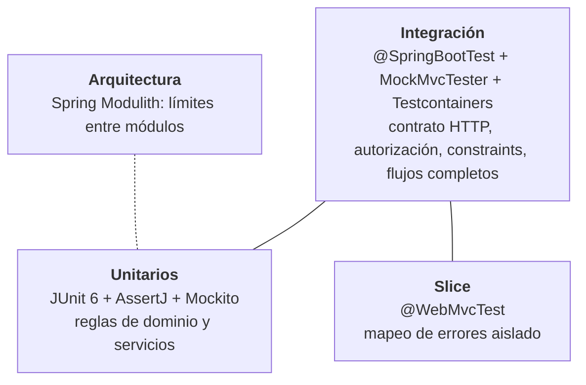
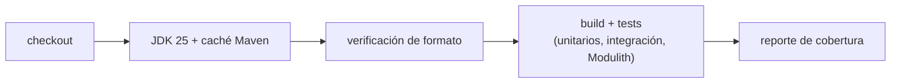

# 6. Calidad y flujo de trabajo

## 6.1 Estrategia de testing

La base de la estrategia son los **tests de integración contra un PostgreSQL real** a través de [Testcontainers](https://testcontainers.com/). Así se prueban el mismo SQL, las mismas constraints y la misma cadena de seguridad que corren en producción. Los tests unitarios cubren las reglas que no necesitan Spring, y los tests de *slice* se reservan para piezas que conviene aislar.



| Nivel | Qué prueba | Ejemplo |
|-------|------------|---------|
| Integración | Contrato HTTP, validación, **autorización** de cada endpoint, constraints de la base y flujos completos | `POST /movies` sin token → 401, con `USER` → 403, inválido → 400 con `ProblemDetail`. Desactivar → solicitar la reactivación → un admin aprueba → se puede volver a iniciar sesión. |
| Unitario | Reglas de negocio puras, sin Spring | "un episodio no se puede reproducir si su serie está retirada", "solo reutilizar un refresh token rotado revoca toda la familia" |
| [`@WebMvcTest`](https://docs.spring.io/spring-boot/reference/testing/spring-boot-applications.html#testing.spring-boot-applications.spring-mvc-tests) | Piezas web que conviene probar aisladas | Cada tipo de excepción se convierte en el `ProblemDetail` correcto |
| Arquitectura | Que no haya ciclos ni accesos a internos de otro módulo | [`ApplicationModules.of(...).verify()`](https://docs.spring.io/spring-modulith/reference/verification.html) |

Las consultas complejas que lleguen en fases siguientes (por ejemplo, "Seguir viendo" o las recomendaciones) pueden sumar tests [`@DataJpaTest`](https://docs.spring.io/spring-boot/reference/testing/spring-boot-applications.html#testing.spring-boot-applications.autoconfigured-spring-data-jpa) específicos.

**Convenciones:**

- El nombre de cada test describe un comportamiento: `shouldKeepExactPositionWhenMarkingAsCompleted()`.
- Estructura *given / when / then*.
- Un contenedor de PostgreSQL compartido por toda la suite, con [`@ServiceConnection`](https://docs.spring.io/spring-boot/reference/testing/testcontainers.html#testing.testcontainers.service-connections). Como los tests comparten la base, cada uno crea sus propios datos (por ejemplo, usuarios con emails únicos) y no depende de un estado inicial vacío.
- La cobertura se mide con [JaCoCo](https://www.jacoco.org/jacoco/) y se publica en CI. Es una guía, no una meta: lo que se busca es probar comportamiento, no cubrir líneas.

## 6.2 Estilo y análisis estático

| Herramienta | Propósito |
|-------------|-----------|
| [Spotless](https://github.com/diffplug/spotless) + [Palantir Java Format](https://github.com/palantir/palantir-java-format) | Formato automático y uniforme. La CI falla si el código no está formateado. |
| [EditorConfig](https://editorconfig.org/) | Indentación y finales de línea consistentes en cualquier editor. |
| [Dependabot](https://docs.github.com/code-security/dependabot) | Actualización semanal de las dependencias de Maven, GitHub Actions y Docker Compose. Solo propone versiones publicadas hace al menos 14 días ([`cooldown`](https://docs.github.com/code-security/dependabot/working-with-dependabot/dependabot-options-reference#cooldown-)), para dar tiempo a que se detecte una versión defectuosa o comprometida. |

## 6.3 Integración continua

[GitHub Actions](https://docs.github.com/actions) ejecuta el pipeline en cada push a `main` y en cada pull request:



- La rama `main` está protegida: solo acepta merges desde un PR con la CI en verde.
- Las actions se fijan por SHA de commit (con la versión como comentario), y Dependabot las mantiene actualizadas. Así se evita que un tag modificado ejecute código inesperado ([referencia](https://docs.github.com/actions/security-for-github-actions/security-guides/security-hardening-for-github-actions#using-third-party-actions)).
- Los tests de integración necesitan Docker. Si no está disponible en la máquina local, se omiten (`@Testcontainers(disabledWithoutDocker = true)`); en la CI siempre corren.

## 6.4 Flujo de trabajo con Git

| Aspecto | Convención |
|---------|------------|
| Ramas | [Trunk-based](https://trunkbaseddevelopment.com/): `main` siempre está desplegable y cada tarea usa una rama corta (`feat/catalog-movies`, `fix/…`, `docs/…`). |
| Commits | [Conventional Commits](https://www.conventionalcommits.org/es/v1.0.0/), en inglés: `feat(catalog): add movie CRUD endpoints`. |
| Pull requests | Un PR por funcionalidad. La descripción explica **qué** cambia, **por qué** y cómo probarlo. Si hay una decisión importante, se incluye su ADR. |
| Merge | *Squash merge*, para que el historial de `main` sea legible. |
| Versionado | [SemVer](https://semver.org/lang/es/), con un tag al cerrar cada fase. |
| Changelog | [Keep a Changelog](https://keepachangelog.com/es-ES/1.1.0/). |
| Licencia | [MIT](https://opensource.org/license/mit). |

## 6.5 Definición de terminado

Una funcionalidad está terminada cuando:

- [ ] cumple los criterios de aceptación de la [hoja de ruta](07-hoja-de-ruta.md);
- [ ] tiene tests en los niveles que corresponden, incluidos los de autorización si expone endpoints;
- [ ] la CI está en verde (formato, tests, verificación de módulos);
- [ ] los cambios de esquema están en una migración nueva, porque las migraciones ya aplicadas no se editan nunca;
- [ ] los endpoints están bien descritos en OpenAPI;
- [ ] la documentación refleja el cambio y, si se tomó una decisión importante, hay un ADR;
- [ ] el PR fue revisado.

## 6.6 Estructura del repositorio

```
streamstories/
├── .github/
│   ├── workflows/ci.yml
│   ├── dependabot.yml
│   └── pull_request_template.md
├── docs/                    ← esta documentación
├── src/
├── .editorconfig
├── .env.example             ← variables de entorno necesarias, sin valores reales
├── .gitignore
├── CHANGELOG.md
├── compose.yaml             ← PostgreSQL para desarrollo local
├── LICENSE
├── mvnw, mvnw.cmd, .mvn/    ← Maven Wrapper
├── pom.xml
└── README.md                ← presentación, cómo ejecutar y enlace a docs/
```
