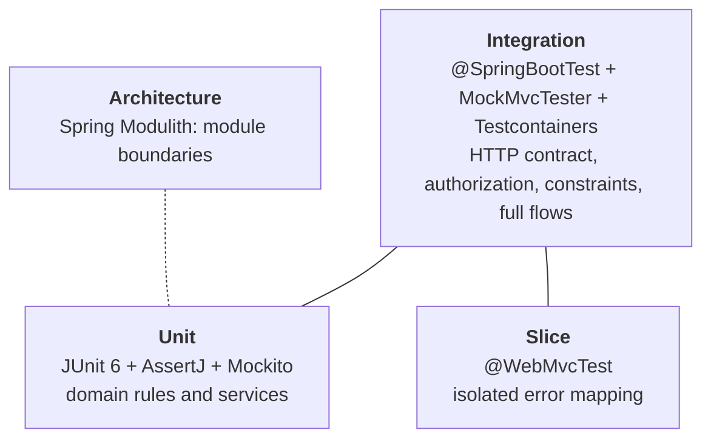
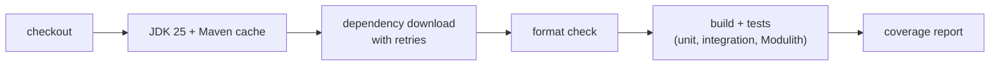

# 6. Quality and workflow

## 6.1 Testing strategy

The strategy rests on **integration tests against a real PostgreSQL** through [Testcontainers](https://testcontainers.com/). They test the same SQL, the same constraints and the same security chain that run in production. Unit tests cover the rules that do not need Spring, and *slice* tests are kept for pieces worth isolating.



| Level | What it tests | Example |
|-------|---------------|---------|
| Integration | HTTP contract, validation, **authorization** of each endpoint, database constraints and full flows | `POST /movies` without a token → 401, as a `USER` → 403, invalid → 400 with a `ProblemDetail`. Deactivate → request reactivation → an admin approves → logging in works again. |
| Unit | Pure business rules, without Spring | "an episode cannot be played if its season or its series is retired", "only reusing a rotated refresh token revokes the whole family", each rule of the recommendation engine |
| [`@WebMvcTest`](https://docs.spring.io/spring-boot/reference/testing/spring-boot-applications.html#testing.spring-boot-applications.spring-mvc-tests) | Web pieces worth testing in isolation | Each kind of exception becomes the right `ProblemDetail` |
| Architecture | No cycles and no access to another module's internals | [`ApplicationModules.of(...).verify()`](https://docs.spring.io/spring-modulith/reference/verification.html) |

**Conventions:**

- Each test name describes a behavior: `shouldKeepExactPositionWhenMarkingAsCompleted()`.
- *Given / when / then* structure.
- One PostgreSQL container shared by the whole suite, with [`@ServiceConnection`](https://docs.spring.io/spring-boot/reference/testing/testcontainers.html#testing.testcontainers.service-connections). Since the tests share the database, each one creates its own data (for example, users with unique emails) and does not rely on an empty initial state.
- Coverage is measured with [JaCoCo](https://www.jacoco.org/jacoco/) and published in CI. It is a guide, not a goal: the aim is to test behavior, not to cover lines.

## 6.2 Style and static analysis

| Tool | Purpose |
|------|---------|
| [Spotless](https://github.com/diffplug/spotless) + [Palantir Java Format](https://github.com/palantir/palantir-java-format) | Automatic, uniform formatting. CI fails if the code is not formatted. |
| [EditorConfig](https://editorconfig.org/) | Consistent indentation and line endings in any editor. |
| [Dependabot](https://docs.github.com/code-security/dependabot) | Weekly updates of the Maven, GitHub Actions and Docker Compose dependencies. It only proposes versions published at least 14 days ago ([`cooldown`](https://docs.github.com/code-security/dependabot/working-with-dependabot/dependabot-options-reference#cooldown-)), to leave time for a broken or compromised release to be noticed. |

Code comments are kept to the ones that explain a non-obvious reason: business rules live in these documents, not in the code.

## 6.3 Continuous integration

[GitHub Actions](https://docs.github.com/actions) runs the pipeline on every push to `main` and on every pull request:



- The `main` branch is protected: it only accepts merges from a PR with a green CI.
- Actions are pinned by commit SHA (with the version as a comment), and Dependabot keeps them updated. That prevents a moved tag from running unexpected code ([reference](https://docs.github.com/actions/security-for-github-actions/security-guides/security-hardening-for-github-actions#using-third-party-actions)).
- Dependencies are downloaded in a step of their own that retries up to three times, so a momentary Maven Central failure does not fail the build.
- Integration tests use the same PostgreSQL image as `compose.yaml`, which they read from there. That way, when Dependabot updates it, it changes in both places.
- Integration tests need Docker. If it is not available on the local machine, they are skipped (`@Testcontainers(disabledWithoutDocker = true)`); in CI they always run.

## 6.4 Git workflow

| Aspect | Convention |
|--------|------------|
| Branches | [Trunk-based](https://trunkbaseddevelopment.com/): `main` is always deployable and each task uses a short-lived branch (`feat/catalog-movies`, `fix/…`, `docs/…`). |
| Commits | [Conventional Commits](https://www.conventionalcommits.org/en/v1.0.0/): `feat(catalog): add movie CRUD endpoints`. |
| Pull requests | One PR per feature. The description explains **what** changes, **why** and how to test it. An important decision comes with its ADR. |
| Merge | *Squash merge*, so the history of `main` stays readable. |
| Versioning | [SemVer](https://semver.org/), with a tag when each phase closes. |
| Changelog | [Keep a Changelog](https://keepachangelog.com/en/1.1.0/). |
| License | [MIT](https://opensource.org/license/mit). |

## 6.5 Definition of done

A feature is done when:

- [ ] it meets the acceptance criteria of the [roadmap](07-roadmap.md);
- [ ] it has tests at the right levels, including authorization tests if it exposes endpoints;
- [ ] CI is green (format, tests, module verification);
- [ ] schema changes are in a new migration, because migrations already applied are never edited;
- [ ] the endpoints are well described in OpenAPI;
- [ ] the documentation reflects the change (in English, and in both READMEs if the README changes) and, if an important decision was made, there is an ADR;
- [ ] the PR was reviewed.

## 6.6 Repository structure

```
streamstories/
├── .github/
│   ├── workflows/ci.yml
│   ├── dependabot.yml
│   └── pull_request_template.md
├── docs/                    ← this documentation
├── src/
├── .editorconfig
├── .env.example             ← required environment variables, without real values
├── .gitattributes           ← line endings of mvnw (LF) and mvnw.cmd (CRLF)
├── .gitignore
├── CHANGELOG.md
├── compose.yaml             ← PostgreSQL for local development
├── LICENSE
├── mvnw, mvnw.cmd, .mvn/    ← Maven Wrapper
├── pom.xml
├── README.md                ← overview, how to run it and link to docs/
└── README.es.md             ← the same README, in Spanish
```
