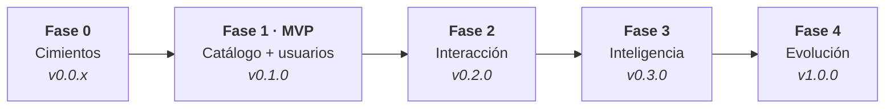

# 7. Hoja de ruta

Cada fase termina con un tag de versión y un sistema funcional, probado y documentado.

## Fase 0: cimientos

**Objetivo:** dejar lista la base técnica antes de la primera funcionalidad.

- `README.md`, `LICENSE`, `.editorconfig`, `.env.example`.
- `compose.yaml` con PostgreSQL, Flyway configurado y `ddl-auto=validate`.
- `application.yaml` con perfiles, virtual threads activados y `open-in-view` desactivado.
- Módulo `shared`: manejo global de errores con `ProblemDetail` y configuración de OpenAPI.
- springdoc-openapi (Swagger UI) y Actuator limitado a `health` e `info`.
- Spring Modulith con `ModularityTests` y la base de Testcontainers.
- CI en GitHub Actions, Spotless, Dependabot y plantilla de PR.

**Criterios de aceptación:**
- `./mvnw spring-boot:run` levanta la aplicación con PostgreSQL y `/actuator/health` responde `UP`.
- `./mvnw verify` pasa en local y en CI.

## Fase 1: MVP (catálogo y usuarios)

**Objetivo:** un catálogo navegable y gestionable, con usuarios autenticados.

| Historia | Criterio de aceptación |
|----------|------------------------|
| Como visitante, quiero registrarme | `POST /auth/register` crea un `USER` activo. Un email duplicado devuelve 409. |
| Como usuario, quiero iniciar sesión | Recibo un access token y un refresh token. Con credenciales inválidas recibo 401 con un mensaje genérico. |
| Como usuario, quiero mantener la sesión | `/auth/refresh` rota el token. Reutilizar uno ya revocado revoca todos los demás. |
| Como usuario, quiero desactivar mi cuenta | Pierdo el acceso de inmediato y mis datos se conservan. |
| Como usuario inactivo, quiero volver | Puedo solicitar la reactivación con mis credenciales. Solo puede haber una solicitud pendiente. |
| Como admin, quiero resolver reactivaciones | Veo las solicitudes pendientes y las apruebo o rechazo. Al aprobar, la cuenta queda activa. |
| Como admin, quiero gestionar usuarios | Listo usuarios y cambio su estado o rol. No puedo dejar el sistema sin un admin activo. |
| Como admin, quiero gestionar el catálogo | ABM de géneros, películas, series, temporadas y episodios, cumpliendo las reglas C1 a C8. |
| Como admin, quiero retirar contenido | Retiro y vuelvo a ofrecer películas, series y temporadas completas. El borrado solo se permite si el contenido no tiene actividad (C9 a C12). |
| Como usuario, quiero explorar el catálogo | `/catalog` devuelve películas y series disponibles, mezcladas, filtrables y paginadas. |
| Como usuario, quiero ver una serie | Veo el detalle con sus temporadas disponibles y sus episodios. |

**Base técnica:** entidad base con identificador UUID y auditoría (`createdAt`, `updatedAt`), que se incorpora junto con las primeras entidades.

**Datos de ejemplo:** el perfil `dev` carga un catálogo de prueba para explorar la API desde el primer momento.

## Fase 2: interacción

**Objetivo:** registrar lo que mira y lo que opina cada usuario.

| Historia | Criterio de aceptación |
|----------|------------------------|
| Como usuario, quiero que se guarde por dónde voy | `PUT /me/progress/...` guarda la posición exacta y marca el contenido como visto al 90 % (A1 a A4). |
| Como usuario, quiero retomar lo que estaba viendo | "Seguir viendo" cumple las reglas A5 a A7. En particular, no avanza al episodio siguiente si el actual no está visto. |
| Como usuario, quiero ver mi historial | Lista paginada con fechas, incluido el contenido retirado marcado como tal. |
| Como usuario, quiero calificar | Una puntuación entera de 1 a 5 por título, que puedo cambiar o borrar. |
| Como usuario, quiero ver cómo está calificado algo | El detalle del título incluye el promedio con un decimal, la cantidad de puntuaciones y mi puntuación. |
| Como usuario reactivado, quiero recuperar mi actividad | Después de desactivar la cuenta y que la reactiven, el historial y las puntuaciones siguen intactos. |

## Fase 3: inteligencia

**Objetivo:** descubrimiento personalizado.

| Historia | Criterio de aceptación |
|----------|------------------------|
| Como usuario, quiero recomendaciones | `/me/recommendations` devuelve títulos disponibles que no vi, ordenados según el [algoritmo](03-modelo-de-dominio.md#35-motor-de-recomendaciones-fase-3). |
| Como usuario, quiero entender por qué | Cada recomendación incluye su `reason`. |
| Como usuario nuevo, quiero recomendaciones igual | Sin actividad previa, recibo los títulos disponibles mejor calificados. |
| Como admin, quiero que no se recomiende lo retirado | El contenido retirado nunca aparece en las recomendaciones. |

## Fase 4: evolución

**Objetivo:** funcionalidades adicionales y preparación para crecer.

- `Watchlist`: guardar títulos para ver después.
- `Franchise`: agrupar películas en sagas ordenadas.
- Límite de intentos de login.
- Optimización: revisar índices con `EXPLAIN ANALYZE` y cachear las recomendaciones y el catálogo si los datos lo justifican.
- Imagen de contenedor de la aplicación con [Cloud Native Buildpacks](https://docs.spring.io/spring-boot/maven-plugin/build-image.html).
- Release `v1.0.0`.
