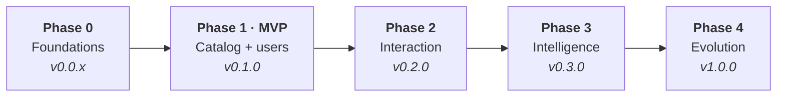

# 7. Roadmap

Each phase ends with a version tag and a working, tested and documented system.

## Phase 0: foundations

**Goal:** have the technical base ready before the first feature.

- `README.md`, `LICENSE`, `.editorconfig`, `.env.example`.
- `compose.yaml` with PostgreSQL, Flyway configured and `ddl-auto=validate`.
- `application.yaml` with profiles, virtual threads enabled and `open-in-view` disabled.
- `shared` module: global error handling with `ProblemDetail`, and OpenAPI configuration.
- springdoc-openapi (Swagger UI) and Actuator limited to `health` and `info`.
- Spring Modulith with `ModularityTests`, and the Testcontainers base.
- CI on GitHub Actions, Spotless, Dependabot and a PR template.

**Acceptance criteria:**
- `./mvnw spring-boot:run` starts the application with PostgreSQL, and `/actuator/health` answers `UP`.
- `./mvnw verify` passes locally and in CI.

## Phase 1: MVP (catalog and users)

**Goal:** a catalog that can be browsed and managed, with authenticated users.

| Story | Acceptance criterion |
|-------|----------------------|
| As a visitor, I want to sign up | `POST /auth/register` creates an active `USER`. A duplicate email returns 409. |
| As a user, I want to log in | I get an access token and a refresh token. With invalid credentials I get a 401 with a generic message. |
| As a user, I want to keep my session | `/auth/refresh` rotates the token. Reusing an already rotated one revokes all the user's refresh tokens. |
| As a user, I want to deactivate my account | I lose access immediately and my data is kept. |
| As an inactive user, I want to come back | I can request reactivation with my credentials. There can only be one pending request. |
| As an admin, I want to resolve reactivations | I see the pending requests and approve or reject them. Once approved, the account is active. |
| As an admin, I want to manage users | I list users and change their status or role. I cannot leave the system without an active admin. |
| As an admin, I want to manage the catalog | Management of genres, movies, series, seasons and episodes, following rules C1 to C8. |
| As an admin, I want to retire content | I retire and offer again movies, series and whole seasons. Deletion is only allowed for content without activity (C9 to C12). |
| As a user, I want to browse the catalog | `/catalog` returns available movies and series, mixed, filterable and paginated. |
| As a user, I want to see a series | I see its detail with its available seasons and their episodes. |

**Technical base:** a base entity with a UUID identifier and auditing (`createdAt`, `updatedAt`), added together with the first entities.

**Sample data:** the `dev` profile loads a sample catalog to explore the API from the start.

## Phase 2: interaction

**Goal:** record what each user watches and what they think.

| Story | Acceptance criterion |
|-------|----------------------|
| As a user, I want my place to be saved | `PUT /me/progress/...` saves the exact position and marks the content as watched at 90% (A1 to A4). |
| As a user, I want to resume what I was watching | "Continue watching" follows rules A5 to A7: unfinished movies and one entry per series with its last watched episode. |
| As a user, I want to see my history | A paginated list with the date each piece of content was last watched, including retired content, marked as such. |
| As a user, I want to rate | An integer score from 1 to 5 per title, which I can change or delete. |
| As a user, I want to see how something is rated | The title detail includes the average with one decimal, the number of ratings and my own score. |
| As a reactivated user, I want my activity back | After deactivating the account and having it reactivated, the history and the ratings are intact. |

## Phase 3: intelligence

**Goal:** personalized discovery.

| Story | Acceptance criterion |
|-------|----------------------|
| As a user, I want recommendations | `/me/recommendations` returns available titles I have neither started nor rated, ordered by the [algorithm](03-domain-model.md#35-recommendation-engine-phase-3). |
| As a user, I want to understand why | Each recommendation includes its `reason`. |
| As a new user, I want recommendations anyway | Without previous activity, I get the best rated available titles. |
| As an admin, I want retired content not to be recommended | Retired content never appears in the recommendations. |

## Phase 4: evolution

**Goal:** additional features and readiness to grow.

- `Watchlist`: save titles to watch later.
- `Franchise`: group movies in ordered franchises.
- Login attempt limit.
- Optimization: review the indexes with `EXPLAIN ANALYZE`, and cache the recommendations and the catalog if the data justifies it ([ADR-0012](adr/0012-measured-performance-without-cache.md)).
- Container image of the application with [Cloud Native Buildpacks](https://docs.spring.io/spring-boot/maven-plugin/build-image.html).
- Release `v1.0.0`.
