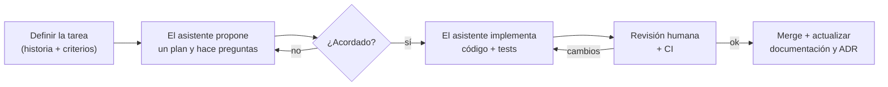

# 8. Desarrollo asistido por IA

StreamStories se desarrolla con [Claude Code](https://docs.claude.com/en/docs/claude-code/overview) como asistente de programación. Este documento describe cómo se integra al proceso y qué controles se aplican.

## 8.1 Principios

1. **Primero el diseño, después el código.** Antes de implementar, el diseño se documenta y se acuerda. Esta documentación y los ADR son la referencia que sigue cada implementación.
2. **Las decisiones son humanas.** El asistente propone alternativas, señala riesgos y pregunta ante cualquier ambigüedad. Las decisiones de arquitectura, alcance y producto las toman personas.
3. **Todo el código se revisa.** El código generado pasa por el mismo proceso que cualquier otro: pull request, CI en verde y revisión humana.
4. **Los tests son la evidencia.** Cada cambio incluye tests que demuestran el comportamiento esperado.
5. **Transparencia.** Los commits en los que participó el asistente lo indican con el trailer [`Co-Authored-By`](https://docs.github.com/pull-requests/committing-changes-to-your-project/creating-and-editing-commits/creating-a-commit-with-multiple-authors).

## 8.2 Flujo de trabajo

## 8.3 Puntos de revisión prioritarios

Al revisar el código generado se presta especial atención a:

- **Seguridad:** reglas de autorización, validación de entrada y que no se filtren datos en errores o logs.
- **Rendimiento de JPA:** consultas N+1, relaciones `EAGER` y transacciones demasiado amplias.
- **Calidad de los tests:** que no tengan asserts débiles ni mocks que solo repitan la implementación.
- **Alcance:** que no haya abstracciones ni dependencias que la tarea no necesita.
