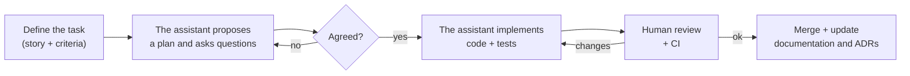

# 8. AI-assisted development

StreamStories is developed with [Claude Code](https://docs.claude.com/en/docs/claude-code/overview) as a programming assistant. This document describes how it fits into the process and which controls apply.

## 8.1 Principles

1. **Design first, code second.** Before implementing, the design is documented and agreed on. This documentation and the ADRs are the reference every implementation follows.
2. **Decisions are human.** The assistant proposes alternatives, points out risks and asks about any ambiguity. People make the architecture, scope and product decisions.
3. **All code is reviewed.** Generated code goes through the same process as any other: a pull request, a green CI and a human review.
4. **Tests are the evidence.** Every change includes tests that show the expected behavior.
5. **Transparency.** Commits the assistant took part in say so with the [`Co-Authored-By`](https://docs.github.com/pull-requests/committing-changes-to-your-project/creating-and-editing-commits/creating-a-commit-with-multiple-authors) trailer.

## 8.2 Workflow

## 8.3 Review priorities

When reviewing generated code, special attention goes to:

- **Security:** authorization rules, input validation, and no data leaking in errors or logs.
- **JPA performance:** N+1 queries, `EAGER` relations and transactions that are too wide.
- **Test quality:** no weak assertions, and no mocks that just repeat the implementation.
- **Scope:** no abstractions or dependencies the task does not need.
