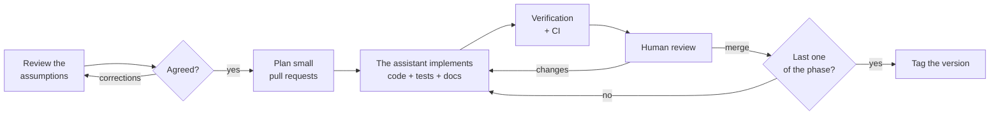

# 8. AI-assisted development

StreamStories was developed with [Claude Code](https://docs.claude.com/en/docs/claude-code/overview) as a programming assistant. This document describes the method, the controls that applied, how the course was corrected along the way, the assistant's mistakes and how the project kept its knowledge from one session to the next.

## 8.1 In numbers

| | |
|---|---|
| Duration | 4 days, from 2026-11-16 to 2026-11-19 |
| Pull requests | More than 30, each one reviewed and merged by a person |
| Versions | `0.0.1`, `0.1.0`, `0.2.0`, `0.3.0` and `1.0.0`, one per [phase](07-roadmap.md) |
| Tests | From 48 in the first phase to 289 in `1.0.0`, the integration ones against a real PostgreSQL |
| Independent reviews | 3, by AI agents without the context of the conversation |
| Product assumptions | 34, each one agreed on before writing code |

## 8.2 Principles

1. **Design first, code second.** Before implementing, the design is documented and agreed on. This documentation and the [ADRs](adr/README.md) are the reference every implementation follows. When code and docs disagree, one of them is fixed in the same pull request.
2. **Decisions are human.** The assistant proposes alternatives, points out risks and asks about any ambiguity. People make the architecture, scope and product decisions, merge every pull request and decide when a version is tagged.
3. **Solve today's requirements.** The focus is on what the product needs now, without adding complexity for future scenarios that may never come.
4. **All code is reviewed.** Generated code goes through the same process as any other: a pull request, a green CI and a human review.
5. **Tests are the evidence.** Every change includes tests that show the expected behavior, and every bug fix includes a test that reproduces it.
6. **Transparency.** Commits the assistant took part in say so with the [`Co-Authored-By`](https://docs.github.com/pull-requests/committing-changes-to-your-project/creating-and-editing-commits/creating-a-commit-with-multiple-authors) trailer.

## 8.3 Workflow

Every phase followed the same cycle:

1. **Review the assumptions.** Before a phase starts, the assistant rereads the business rules and brings the points the docs do not settle, each one with a concrete proposal. For example: "if someone watched 40 episodes of a series, does that add +40 to the affinity for its genres?". The person accepts, corrects or simplifies. A proposal, rather than an open question, turns each decision into a matter of minutes.
2. **Plan small pull requests.** One per feature, in dependency order, so each one can be reviewed in minutes.
3. **Implement with tests.** Every business rule has its test, and the integration tests run against PostgreSQL with Testcontainers.
4. **Verify before delivering.** A full build and a green CI. When it matters, also the real thing: starting the app and calling its endpoints, or following the README step by step on a fresh clone.
5. **Human review and closing.** The person reviews and merges. The phase's last pull request also closes it (changelog, README and version), and the tag is created after it is merged.

## 8.4 Independent reviews

Three times, an AI agent **without the context of the conversation** reviewed the whole project with fresh eyes: the code, the security and whether the documentation matched the code. Each agent had to verify every finding before reporting it, and confirmed the important ones by running them.

They found problems that the tests written with the context of the conversation had not looked for:

- a huge `page` value, or a `null` inside a list, that answered `500`;
- the development profile, with public credentials, packaged inside the jar;
- the limit on failed logins, which could be bypassed with parallel requests: 60 simultaneous requests checked 30 passwords instead of 5;
- two simultaneous changes to the same user that silently lost one of them;
- an expired access token that blocked the endpoint meant to renew it.

Every finding was fixed with a test that reproduces it. Improvements that were not urgent were recorded to be evaluated later.

## 8.5 Course corrections

The person's corrections changed both product decisions and the way of working. These were the most important ones:

| Correction | What changed |
|------------|--------------|
| Solve today's requirements, without preparing for scenarios that may never come | "Continue watching" was going to compute the next episode of each series, skipping retired seasons. It became the series with its last watched episode, which removed three assumptions and a good amount of logic. The same criterion was applied to configuration and documentation. |
| Content is licensed by season, not by episode | Retiring content changed to whole movies, series or seasons, recorded in [ADR-0011](adr/0011-retiring-by-season.md), which supersedes ADR-0009. |
| Only the comments that are indispensable | One pull request removed 201 comments and kept 44 that explain something that is not obvious. New code only comments the why. |
| The whole API in English | Error messages, validations and the OpenAPI documentation. The catalog content stays in Spanish. |
| Failed login attempts in the database, not in memory | The limit works with several instances. The assistant proposed its own table keyed by a hash of the email, so non-existent emails also count and a `429` does not reveal which accounts exist. |
| Explain every feature | Each new feature is explained in the [vision and scope](01-vision-and-scope.md) document. |
| The fix and the phase closing in the same pull request | It became the rule for every following phase. |

## 8.6 The assistant's mistakes

The assistant also made mistakes. What matters is that each one was caught and left a practice behind so it does not happen again.

| What happened | How it was caught | The practice it left |
|---------------|-------------------|----------------------|
| After a product rule changed, traces of the old version remained in several docs | The person asked whether the docs had been updated everywhere | Search every doc before considering a change finished |
| Two pull requests that passed on their own broke `main` together: one test took "the first result" of a search, and another one created a similar title | The CI on `main` | Tests never assume a search returns only their own data, because the database is shared |
| The integration tests were skipped silently because Docker was not running, so a green build proved nothing | The assistant noticed a suspiciously low number of tests | Check that no tests were skipped before reporting a green build |
| A test clone connected to the developer's local database, because the folders had the same name | The assistant, from the container's name | Always use a separate Compose project name for tests |
| A test process kept running and held port 8080 | The person, who could not start the app | Check that no process or container is left after a test |
| A temporary Maven Central failure broke the CI on `main` | The person reported it | The CI retries the dependency download |

## 8.7 How the knowledge was kept

An AI session does not remember anything on its own. The project kept its knowledge in four places, and every new session started from them:

| Place | What it holds | Published |
|-------|---------------|:---------:|
| `docs/` and the ADRs | Business rules, architecture, API, security and the reason behind each decision | Yes |
| Assistant guide | Commands, code and test conventions, and known traps, such as stale classes in `target/` after switching branches | No |
| Working notes | The agreed assumptions, the decisions not yet in the docs, the status of each phase, and the improvements to evaluate | No |
| Assistant memory | The person's preferences that must always apply, each one with its reason | No |

Each time the person corrected something that should apply from then on, it went to the guide or to the memory. When a session ran out of context, it resumed from a summary and from these sources without losing any decision.

## 8.8 Rules that were not negotiable

- **The repository is public.** Local configuration and working notes are never versioned.
- **Privacy.** Commits use GitHub's anonymous `noreply` address.
- **Least privilege.** The assistant accesses GitHub with a token limited to this repository and to the permissions it needs. When a permission was missing, it asked the person instead of looking for a shortcut.
- **Nothing reaches `main` without a pull request, a green CI and a human merge.** Tags are created only with an explicit approval.
- **Supply chain.** New dependencies must have been published at least two weeks earlier, and GitHub Actions are pinned by commit hash.

## 8.9 Review priorities

When reviewing generated code, special attention goes to:

- **Security:** authorization rules, input validation, and no data leaking in errors or logs.
- **Concurrency:** check-then-act sequences, lost updates and limits that parallel requests can bypass.
- **JPA performance:** N+1 queries, `EAGER` relations and transactions that are too wide.
- **Test quality:** no weak assertions, and no mocks that just repeat the implementation.
- **Scope:** no abstractions or dependencies the task does not need.

## 8.10 What worked

- **Writing the rules before the code** gave every pull request an objective definition of done, and let the reviewers compare the docs against the code.
- **Small pull requests in order** made it possible to review everything without losing the thread.
- **Measuring before optimizing.** Instead of adding a cache just in case, 6,000 titles and 300,000 ratings were loaded and measured. Recommendations went from 386 to 146 ms without a cache, and the decision is in [ADR-0012](adr/0012-measured-performance-without-cache.md) with its numbers.
- **Reviews without context** found concurrency bugs that no test had looked for.
- **Trying it as a newcomer.** Cloning the repository and following the README to the letter confirmed that the instructions really work.
